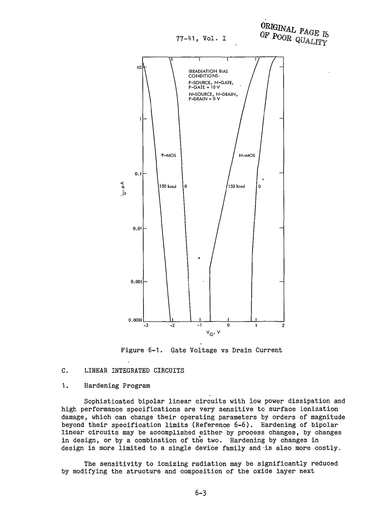
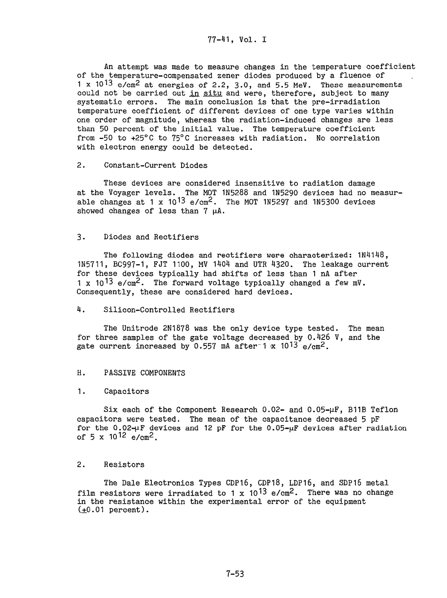
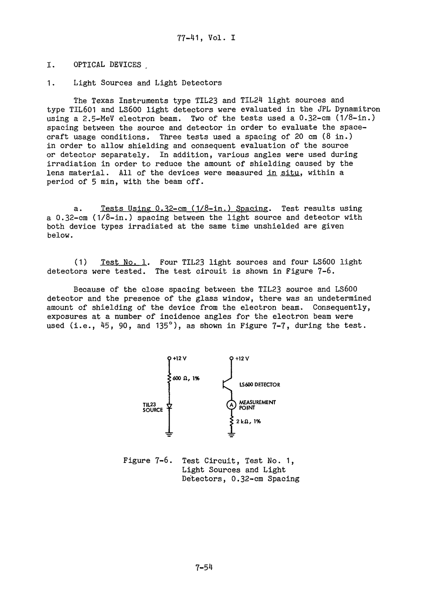

# Fuentes y figuras

Consulta: 14 de octubre de 2026. Las páginas PDF se cuentan desde 1 e incluyen portada; se indica además la página impresa cuando difiere. El catálogo conserva URL, fecha de consulta, tamaño y SHA-256.

Se priorizan documentos originales NASA/JPL/GSFC, NTRS, PDS y NEPP. S28 es la excepción técnica de Vanderbilt. Los manuales generales explican física; no demuestran instalación ni práctica de vuelo. S32 es material consultado auxiliar.

## S01 — Voyager Electronic Parts Radiation Program Volume I

Fecha: 1977-09-15. [Original en línea](https://ntrs.nasa.gov/api/citations/19780007219/downloads/19780007219.pdf) · [Copia local](../citas/voyager_radiacion_vol1_1977.pdf). Estado: descargado.

Stanley, Martin y Price; JPL 77-41. §II y tabla 2-1: p. 2-2 / PDF 26. Tabla 3-1: p. 3-6 / PDF 34. CMOS: pp. 6-1–6-3 / PDF 81–83, figura 6-1. Pasivos: p. 7-53 / PDF 151. Circuito óptico de ensayo: figura 7-6, PDF 152. Cristales: p. 8-41 / PDF 202.

## S02 — Voyager Electronic Parts Radiation Program Volume II

Fecha: 1978-12-15. [Original en línea](https://ntrs.nasa.gov/api/citations/19790006102/downloads/19790006102.pdf) · [Copia local](../citas/voyager_radiacion_vol2_1978.pdf). Estado: descargado.

Apéndice A, pp. A-1–A-6 / PDF 9–14; tablas A-1, A-2 y A-3. Apéndice E: irradiación y recocido de selección. La tabla A-2 contiene una inconsistencia de exponente, discutida en el dossier.

## S03 — Voyager Backgrounder

Fecha: 1981. [Original en línea](https://ntrs.nasa.gov/api/citations/19810023559/downloads/19810023559.pdf) · [Copia local](../citas/voyager_background_1981.pdf). Estado: descargado.

Potencia: pp. 15–17 / PDF 18–20. AACS: p. 20 / PDF 23. RF: p. 9 / PDF 12. Documento histórico, no inventario del estado de 2026.

## S04 — Computers in Spaceflight The NASA Experience

Fecha: 1988. [Original en línea](https://ntrs.nasa.gov/api/citations/19880069935/downloads/19880069935_Optimized.pdf) · [Copia local](../citas/computers_spaceflight_1988.pdf). Estado: descargado.

James E. Tomayko, NASA SP-2000. Capítulo 6, pp. 178–184 / PDF 183–189. Recuadros 6-1 y 6-2, figura 6-2. Distinguir prototipo TTL de diseño CMOS.

## S05 — Voyager Frequently Asked Questions

Fecha: sin fecha estable. [Original en línea](https://science.nasa.gov/mission/voyager/frequently-asked-questions/) · [Copia local](../citas/S05_voyager_faq.html). Estado: descargado.

Preguntas sobre computadoras, memoria y velocidad. Conservar discrepancia 8198 frente a 8K; no usar la conversión inconsistente de 80 µs.

## S06 — Voyager Fact Sheet

Fecha: contenido histórico sin fecha única. [Original en línea](https://science.nasa.gov/mission/voyager/fact-sheet/) · [Copia local](../citas/S06_voyager_fact_sheet.html). Estado: descargado.

Sección History: lanzamientos y encuentros. La página contiene información histórica; no usar sus secciones antiguas como estado actual.

## S07 — Where Are Voyager 1 and 2 Now

Fecha: consulta 2026-10-14. [Original en línea](https://science.nasa.gov/mission/voyager/where-are-voyager-1-and-voyager-2-now/) · [Copia local](../citas/S07_estado_voyager.html). Estado: descargado.

Tabla Instrument Status y aviso del futuro hito de un día luz. Consultada al corte; la tabla de distancias dinámicas no se recuperó como efeméride estática.

## S08 — A Plasma Wave Investigation for the Voyager Mission

Fecha: 1977. [Original en línea](https://pds.nasa.gov/data/vg1-j-spice-6-spk-v2.0/vg_1501/document/pws/pwsinst.htm) · [Copia local](../citas/S08_pws_instrumento_1977.html). Estado: descargado.

F. L. Scarf y D. A. Gurnett, Space Science Reviews 21 (1977), 289–308; reproducción en NASA PDS. §5.C construcción; §5.E radiación; §5.G potencial de antena y equipotencialidad. Figuras del instrumento: ver vínculos en HTML; la copia local del HTML no incluye automáticamente imágenes remotas.

## S09 — Voyager CRS Instrument Problems

Fecha: actualización indicada 2025-11-19. [Original en línea](https://voyager.gsfc.nasa.gov/instrument_problems.html) · [Copia local](../citas/S09_crs_problemas.html). Estado: descargado.

Apartados de daño por Júpiter y calibración con calentadores apagados. Distinguir daño observado de hipótesis de implantación O/S.

## S10 — Voyager 2 FDS reset May 2010

Fecha: 2010. [Original en línea](https://voyager.gsfc.nasa.gov/Library/V2_FDS_reset.pdf) · [Copia local](../citas/S10_voyager2_memoria_2010.pdf). Estado: descargado.

Cronología de mayo de 2010, lectura de memoria, bit alterado y verificación. Complementar con actualizaciones fechadas de S34.

## S11 — Engineers Pinpoint Cause of Voyager 1 Issue

Fecha: 2024-04-04. [Original en línea](https://science.nasa.gov/blogs/voyager/2024/04/04/engineers-pinpoint-cause-of-voyager-1-issue-are-working-on-solution/) · [Copia local](../citas/S11_voyager1_memoria_2024.html). Estado: descargado.

Párrafos sobre 3 % de memoria y posible chip; causas propuestas: partícula energética o desgaste. Diagnóstico preliminar del 4 de abril.

## S12 — Voyager 1 Resumes Sending Engineering Updates

Fecha: 2024-04-22. [Original en línea](https://www.jpl.nasa.gov/news/nasas-voyager-1-resumes-sending-engineering-updates-to-earth/) · [Copia local](../citas/S12_lectura_web.txt). Estado: copia_textual_web; HTML original rechazó descarga HTTP 403.

Párrafos sobre chip averiado y redistribución de código; recuperación de telemetría de ingeniería en abril de 2024.

## S13 — Voyager Will Do More Science With New Power Strategy

Fecha: 2023-04-26. [Original en línea](https://www.jpl.nasa.gov/news/nasas-voyager-will-do-more-science-with-new-power-strategy/) · [Copia local](../citas/S13_lectura_web.txt). Estado: copia_textual_web; HTML original rechazó descarga HTTP 403.

Sección Power to the Probes: potencia reservada para protección y menor regulación. Sus previsiones de apagados no sustituyen noticias posteriores.

## S14 — NASA Shuts Off Instrument on Voyager 1

Fecha: 2026-04-17. [Original en línea](https://science.nasa.gov/blogs/voyager/2026/04/17/nasa-shuts-off-instrument-on-voyager-1-to-keep-spacecraft-operating/) · [Copia local](../citas/S14_voyager1_2026.html). Estado: descargado.

Apagado LECP de Voyager 1 del 17 de abril de 2026, MAG/PWS y distancia publicada en esa fecha.

## S15 — NASA Engineers Help Prolong Voyager 2 Science Mission

Fecha: 2026-08-04. [Original en línea](https://science.nasa.gov/blogs/voyager/2026/08/04/nasa-engineers-help-prolong-voyager-2s-science-mission/) · [Copia local](../citas/S15_voyager2_2026.html). Estado: descargado.

Reconfiguración energética de Voyager 2 y continuidad de tres instrumentos; distinguir lo realizado de lo previsto para Voyager 1.

## S16 — NASA Turns Off 2 Voyager Science Instruments

Fecha: 2025-03-05. [Original en línea](https://science.nasa.gov/blogs/voyager/2025/03/05/nasa-turns-off-2-voyager-science-instruments-to-extend-mission/) · [Copia local](../citas/S16_voyager_2025.html). Estado: descargado.

Apagados de 2025 y distancias fechadas. Planes para 2026 revisados posteriormente por S15.

## S17 — Cosmic Rays Introduction NASA GSFC

Fecha: sin fecha estable. [Original en línea](https://imagine.gsfc.nasa.gov/science/toolbox/cosmic_rays1_orig.html) · [Copia local](../citas/S17_rayos_cosmicos.html). Estado: descargado.

Introducción, composición y origen de rayos cósmicos; contexto general, no dosimetría Voyager.

## S18 — Voyager CRS Data

Fecha: actualización indicada 2025-11-19. [Original en línea](https://voyager.gsfc.nasa.gov/data.html) · [Copia local](../citas/S18_crs_datos.html). Estado: descargado.

Diferencia entre tasas y flujos corregidos térmicamente; acceso a datos CRS.

## S19 — Voyager CRS Flux Time History

Fecha: consulta 2026-10-14. [Original en línea](https://voyager.gsfc.nasa.gov/flux.html) · [Copia local](../citas/S19_crs_flujos.html). Estado: descargado.

Unidades de intensidad diferencial y notas de corrección; formulario interactivo no reproducido por el HTML local.

## S20 — Voyager 2 PGH Rate six hour averages

Fecha: mediciones 2026. [Original en línea](https://voyager.gsfc.nasa.gov/_recent/data/v2_3m_ipgh.txt) · [Copia local](../citas/v2_pgh_consultado_2026-10-14.txt). Estado: descargado.

Encabezado y última fila del archivo descargado: 2026-10-04 06:00 UTC, 2,369 cuentas/s y ERROR 0,0257. Archivo congelado para que una actualización web no cambie el dato citado.

## S21 — Radiation Effects on Electronics 101 Kenneth LaBel

Fecha: 2004-04-21. [Original en línea](https://nepp.nasa.gov/DocUploads/392333B0-7A48-4A04-A3A72B0B1DD73343/Rad_Effects_101_WebEx.pdf) · [Copia local](../citas/radiation_effects_101.pdf). Estado: descargado.

Kenneth A. LaBel, NASA GSFC. PDF p. 9 LET; pp. 14–24 clasificación y mecanismos; glosario pp. 59–60. Fuente general, no calificación de Voyager.

## S22 — JPL ASIC Guide Design for Radiation Tolerance

Fecha: sin fecha estable. [Original en línea](https://parts.jpl.nasa.gov/asic/Sect.3.4.html) · [Copia local](../citas/S22_jpl_asic_radiacion.html). Estado: descargado.

Design for Radiation Tolerance: ionización, carga atrapada, interfaces y condiciones de evaluación. Guía histórica; no catálogo de tecnologías actuales.

## S23 — JPL ASIC Guide Appendix Three

Fecha: sin fecha estable. [Original en línea](https://parts.jpl.nasa.gov/asic/Appendix.3.html) · [Copia local](../citas/S23_jpl_fisica.html). Estado: descargado.

Apéndice de física de efectos radiativos en microelectrónica, complemento de S22.

## S24 — Radiation Effects and Analysis Lessons Wyrwas Wilcox

Fecha: 2022-06. [Original en línea](https://nepp.nasa.gov/docs/etw/2022/16-JUN-THU/1600-Wyrwas-20220002512.pdf) · [Copia local](../citas/nepp_radiation_lessons_2022.pdf). Estado: descargado.

J. Wyrwas y E. Wilcox, NASA NEPP. PDF pp. 47–50: tendencias con reservas; p. 49: capacitores cerámicos y conductividad inducida.

## S25 — NASA HDBK 4002B Mitigating In Space Charging Effects

Fecha: 2022-06-07. [Original en línea](https://standards.nasa.gov/sites/default/files/standards/NASA/B/0/2022-06-07-NASA-HDBK-4002B-Approved.pdf) · [Copia local](../citas/nasa_hdbk_4002b_2022.pdf). Estado: descargado.

NASA-HDBK-4002B. §§4.1.2–4.1.5, PDF pp. 30–32: carga interna, dieléctricos y metales flotantes. Tabla 5, pp. 87–88: ejemplos históricos. Guía general posterior, no prueba de cada práctica Voyager.

## S26 — MIL HDBK 978B NASA Parts Application Handbook Volume 4

Fecha: 1988-03-01. [Original en línea](https://nepp.nasa.gov/files/21544/MIL-HDBK-978B_vol4.pdf) · [Copia local](../citas/nasa_parts_handbook_vol4.pdf). Estado: descargado.

Volumen 4. §10.2.6.5 p. 10-22 / PDF 72: magnetismo y aislamiento. §8.6.8 pp. 8-23–8-24: cuarzo.

## S27 — The Effects of Radiation on the Outer Planets Grand Tour

Fecha: 1971-11-01. [Original en línea](https://ntrs.nasa.gov/api/citations/19720018918/downloads/19720018918.pdf) · [Copia local](../citas/outer_planets_radiation_1971.pdf). Estado: descargado.

Estudio previo del Grand Tour, no informe de construcción final Voyager. pp. 156–157 / PDF 165–166: pasivos y activos.

## S28 — CREME MC Sensitive Volumes Vanderbilt

Fecha: sin fecha estable. [Original en línea](https://creme.isde.vanderbilt.edu/CREME-MC/help/sensitive-volumes) · [Copia local](../citas/S28_creme_volumen_sensible.html). Estado: descargado.

Sensitive Volumes: generación de pares en silicio y ponderación por colección. Fuente técnica primaria de Vanderbilt; excepción explícita a NASA/JPL.

## S29 — The Voyage to Interstellar Space

Fecha: 2019-03-27. [Original en línea](https://www.nasa.gov/solar-system/the-voyage-to-interstellar-space/) · [Copia local](../citas/S29_espacio_interestelar.html). Estado: descargado.

Cruces de heliopausa de ambas sondas y cambio de poblaciones observadas.

## S30 — Voyager 1 and 2 Cosmic Ray Subsystem PDS

Fecha: documento de instrumento. [Original en línea](https://pds.nasa.gov/data/vg1-j-pls-5-summ-ele-mom-96.0sec-v1.1/vg_1501/document/crs/crsdata.htm) · [Copia local](../citas/S30_crs_instrumento.html). Estado: descargado.

Descripción CRS: telescopios, aceptación y respuesta. Para interpretar mediciones, no inferir dosis dentro de chips.

## S31 — How NASA Prepares Spacecraft for Harsh Radiation

Fecha: 2019. [Original en línea](https://science.nasa.gov/science-research/heliophysics/how-nasa-prepares-spacecraft-for-the-harsh-radiation-of-space/) · [Copia local](../citas/S31_nasa_preparacion.html). Estado: descargado.

Explicación NASA de preparación de naves para radiación; contexto y lectura inicial.

## S32 — JPL Horizons API Documentation

Fecha: 2025-06. [Original en línea](https://ssd-api.jpl.nasa.gov/doc/horizons.html) · [Copia local](../citas/S32_horizons_api.html). Estado: descargado.

Documentación de Horizons API. Consultada para explorar efemérides; no se obtuvo una solución numérica utilizable y no se cita una distancia calculada con ella.

## S33 — Voyager 2 PGH Rate documentation

Fecha: consulta 2026-10-14. [Original en línea](https://voyager.gsfc.nasa.gov/v2pgh.html) · [Copia local](../citas/S33_pgh_documentacion.html). Estado: descargado.

PGH Rate: umbral del canal y promedios de seis horas, complemento de S20.

## S34 — Engineers Diagnosing Voyager 2 Data System Update

Fecha: 2010-05. [Original en línea](https://www.jpl.nasa.gov/news/engineers-diagnosing-voyager-2-data-system-update/) · [Copia local](../citas/S34_lectura_web.txt). Estado: copia_textual_web; HTML original rechazó descarga HTTP 403.

Actualizaciones del 17, 20 y 24 de mayo de 2010: identificación 0→1, corrección y regreso de datos científicos.

## Figuras incluidas y procedencia

- **Mapa de componentes:** elaboración propia, síntesis de S01, S21, S24–S27 y el dossier. No reproduce un plano de vuelo. PNG y SVG en `figuras/`.
- **S01, PDF 26:** tabla 2-1, ambiente previo al vuelo. Sirve para discutir umbrales y equivalencias, no para asignar dosis actual.
- **S01, PDF 34:** tabla 3-1, requisitos de blindaje por localización. Relacionar con margen de diseño.
- **S01, PDF 83:** figura 6-1, curvas MOS antes y después de irradiación. Observar desplazamiento bajo las condiciones indicadas en el original.
- **S01, PDF 151:** resultados de diodos, capacitores y redes resistivas. Los valores son del ensayo descrito, no una garantía universal.
- **S01, PDF 152:** figura 7-6, montaje de ensayo óptico. Identifica alimentación y resistencias de un banco de prueba; no es una placa Voyager.
- **S02, PDF 13:** tabla A-2, secuencia de irradiación. El exponente de fluencia final discrepa del cálculo y de A-3.

Las páginas son reproducciones renderizadas de los PDF NASA/JPL, sin reconstruir ni alterar curvas o cifras. Las imágenes remotas enlazadas por otros HTML no se incluyen salvo indicación expresa.

**Figura de respaldo A.** S01, p. 6-3. Leer condiciones y ejes en la página: un corrimiento de característica modifica el margen eléctrico del circuito.

**Figura de respaldo B.** S01, p. 7-53. Permite verificar los valores de capacitancia usados en el cálculo y las familias de resistencias ensayadas.

**Figura de respaldo C.** S01, p. 7-54. Ejemplo real de prueba que integra componentes discretos; no presentarlo como esquema de vuelo.
