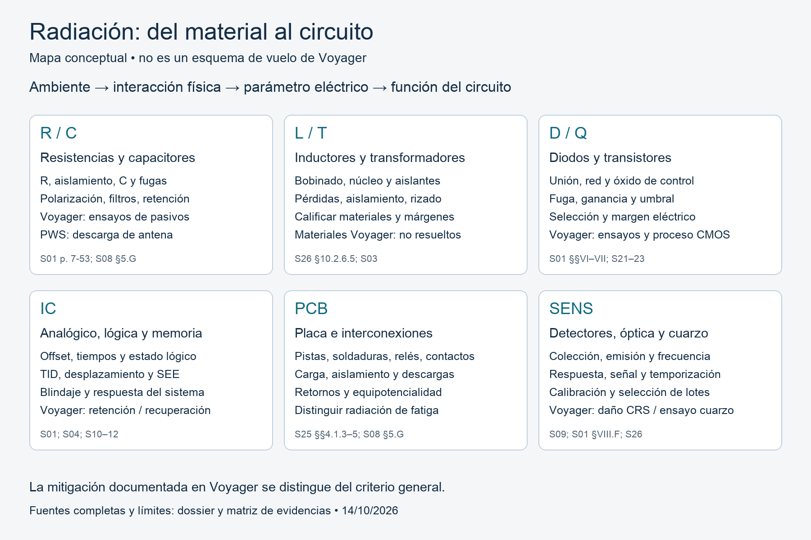

# Radiación y componentes electrónicos de Voyager

Investigación para electrónica universitaria, actualizada al **14 de octubre de 2026**. El foco es cómo la radiación altera cada parte de un circuito y qué decisiones de ingeniería ayudan a entender la longevidad de Voyager.

La evidencia muestra una combinación de calificación de componentes, márgenes de circuito, cambios de fabricación, blindaje localizado y recuperación operativa. La misión continuó a pesar de daños y pérdida de capacidades: su longevidad no demuestra inmunidad de sus componentes.

## Orden de lectura

1. [Dossier técnico](01_dossier.md): física, componentes, hardware, exposición y conclusiones.
2. [Matriz de evidencias](02_matriz_evidencias.md): qué está documentado, qué se infiere y qué falta resolver.
3. [Síntesis para 20 minutos](03_sintesis_20min.md): selección de contenidos alrededor del mapa del circuito.
4. [Fuentes y figuras](04_fuentes.md): bibliografía con localizadores y procedencia de imágenes.
5. [Validación y límites](05_validacion.md): cálculos, discrepancias y cobertura de preguntas.
6. [Consignas transcritas](00_consignas.md): TXT original e imágenes.

## Mapa del circuito

Esquema conceptual propio para organizar la investigación. No representa un circuito de vuelo ni identifica conexiones específicas de Voyager. La matriz es la referencia para distinguir evidencia de vuelo, ensayos del programa y mitigación general.

## Material de respaldo

[`../citas/`](../citas/README.md) contiene las fuentes originales descargadas y copias de texto con numeración PDF o contenido HTML. El texto automático puede confundir µ con p o exponentes; los valores utilizados de las tablas principales se cotejaron visualmente con el PDF.

`figuras/` contiene el mapa original y páginas técnicas de respaldo. `scripts/` contiene la descarga de fuentes y la generación del mapa y sus índices. Las referencias web se consultaron el 14 de octubre de 2026; la fecha de publicación o medición se especifica por separado.
