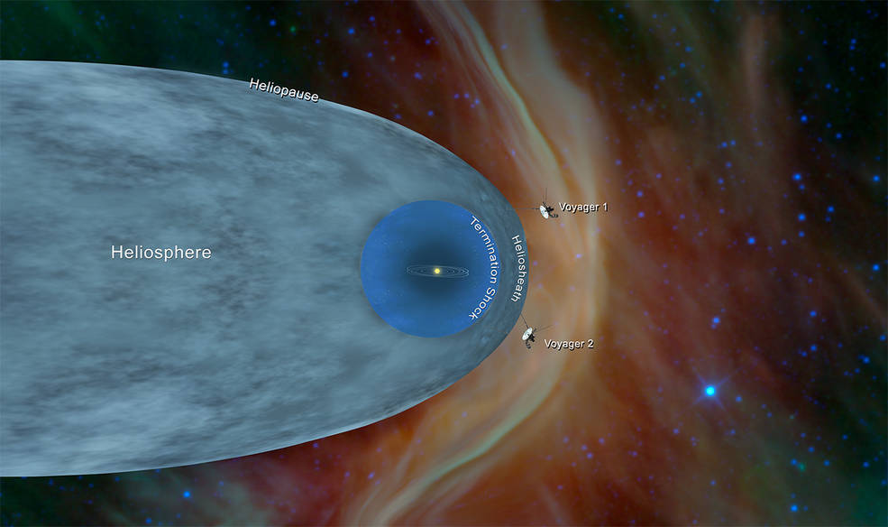
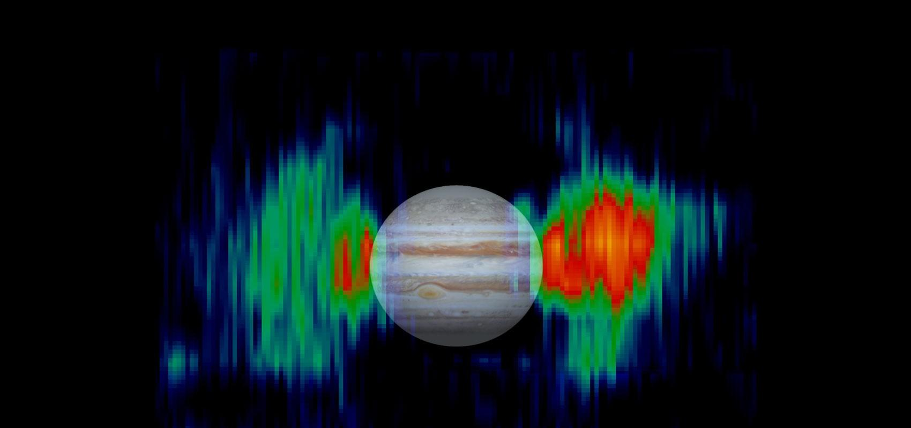
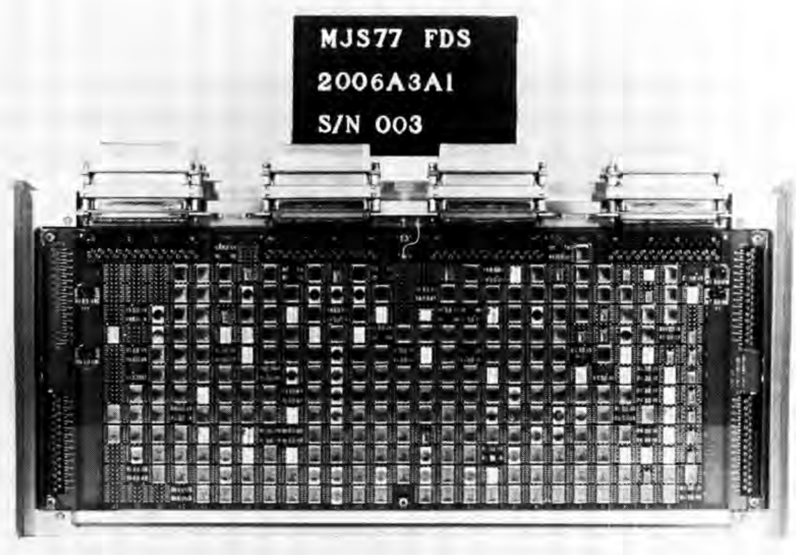
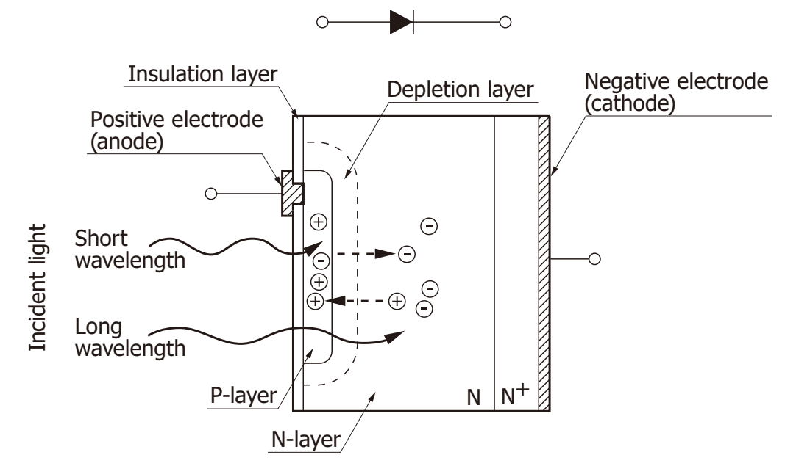
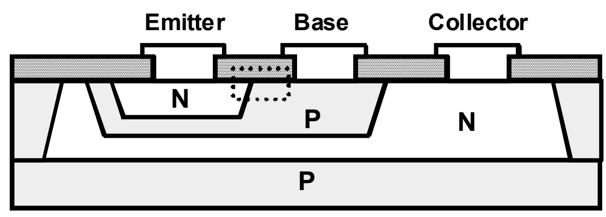
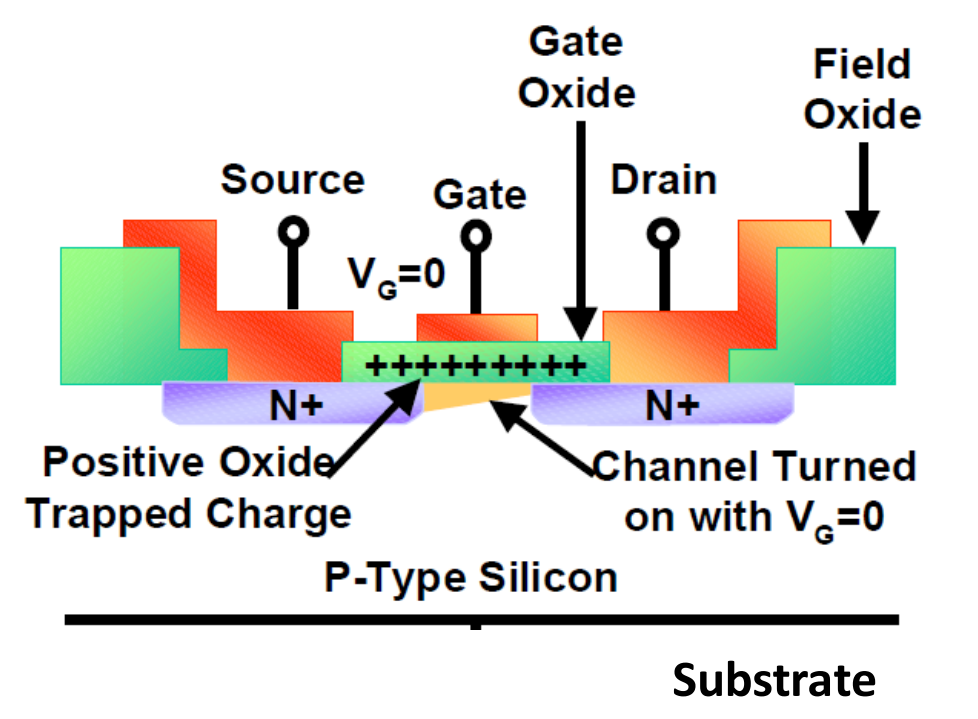

# Voyager: radiación, componentes y decisiones de diseño

Ignacio Cavicchioli

Versión 2 revisada · 16 de octubre de 2026

Dossier de estudio en el mismo orden que las 18 diapositivas.

Este documento amplía lo que se muestra en pantalla. Las explicaciones generales se distinguen de ensayos del programa y de hardware identificado. Las referencias S01-S37 conservan la numeración del repositorio; S38-S41 agregan fuentes de contexto. Las páginas PDF se cuentan desde la portada.

## Recorrido

1. Casi 50 años de electrónica en el espacio
2. Dos sondas, dos recorridos
3. El recorrido define el ambiente
4. Las fuentes de radiación
5. Partículas, fotones e ionización
6. Tipo, energía, flujo y dosis
7. Qué contiene Voyager
8. Computadoras, memoria y almacenamiento
9. Resistencias: valor y aislamiento
10. Capacitores: conservar el aislamiento
11. Bobinados, relés e interconexiones
12. Diodos y optoelectrónica
13. TBJ: recombinación y ganancia
14. JFET, MOSFET y CMOS
15. Memorias y registros: un estado equivocado
16. Amplificadores y referencias de tiempo
17. Exposición prevista y margen de diseño
18. Las decisiones que siguen dando resultado

## 01. Casi 50 años de electrónica en el espacio

**Idea de la diapositiva.** Voyager lleva casi cinco décadas funcionando lejos de la Tierra. Vamos a recorrer las decisiones electrónicas que ayudaron a sostener esa misión.

*Figura del capítulo 1. Voyager · NASA/JPL. Identificar la antena y el cuerpo central. La imagen presenta la nave; no muestra sus circuitos internos.*

### La pregunta de esta presentación

Una sonda puede seguir comunicándose aunque parte de sus instrumentos ya no funcione o se haya apagado para ahorrar energía. Por eso, explicar la longevidad de Voyager exige precisar qué significa «seguir funcionando»: conservar funciones útiles de alimentación, control, comunicación y medición durante una misión que se extendió mucho más allá de sus objetivos iniciales. No significa que todos los componentes hayan mantenido sus parámetros originales. [S01, §I; S07; S09]

El recorrido de este dossier sigue una pregunta de ingeniería. Primero identificamos el ambiente. Después estudiamos qué entra en el equipo y cómo interactúa con sus materiales. Finalmente conectamos el cambio físico con una consecuencia eléctrica y con una decisión de diseño. Una partícula puede generar una corriente breve; esa corriente puede convertirse en una lectura equivocada; la lectura puede desaparecer o quedar guardada como un dato. No hace falta destruir el chip para alterar una función.

### Cómo leer la evidencia

En los capítulos distinguimos tres situaciones. «Documentado en Voyager» identifica un dato de diseño, un ensayo o una observación, especificando cuál de ellos es. «Explicación general» presenta física aplicable sin atribuirla a una placa concreta. «No identificado» señala que falta una lista de materiales, un plano o una prueba para afirmar algo del hardware de vuelo. Una pieza incluida en una campaña de ensayos no queda automáticamente identificada como instalada en ambas sondas.

La hipótesis de trabajo es que la duración se explica por una combinación de componentes evaluados, procesos de fabricación, márgenes, blindaje localizado, redundancia y operaciones. Los capítulos mostrarán evidencia concreta de esa combinación. La disponibilidad de potencia, el control térmico y el trabajo de los equipos de Tierra también importan, aunque aquí el desarrollo se concentra en radiación y electrónica.

### Vocabulario que vamos a necesitar

Un portador es una carga móvil en el material: electrón o hueco. Un hueco describe la ausencia de un electrón en estados de la banda de valencia y se trata como un portador positivo. Generar un par electrón-hueco no crea carga neta: produce dos portadores de signos opuestos. Un campo puede separarlos y producir corriente. Una trampa puede capturar y liberar portadores; un centro de recombinación puede facilitar la desaparición de un par. Esa diferencia será importante al estudiar bipolares y MOS.

### Fuente y alcance

S01, §I y §III; S22-S23, física general.

**S01.** Voyager Electronic Parts Radiation Program Volume I. [1977-09-15](https://ntrs.nasa.gov/api/citations/19780007219/downloads/19780007219.pdf)

**S07.** Where Are Voyager 1 and 2 Now. [consulta 2026-10-14](https://science.nasa.gov/mission/voyager/where-are-voyager-1-and-voyager-2-now/)

**S09.** Voyager CRS Instrument Problems. [actualización indicada 2025-11-19](https://voyager.gsfc.nasa.gov/instrument_problems.html)

**S22.** JPL ASIC Guide Design for Radiation Tolerance. [sin fecha estable](https://parts.jpl.nasa.gov/asic/Sect.3.4.html)

**S23.** JPL ASIC Guide Appendix Three. [sin fecha estable](https://parts.jpl.nasa.gov/asic/Appendix.3.html)

## 02. Dos sondas, dos recorridos

**Idea de la diapositiva.** Voyager 2 partió el 20 de agosto de 1977 y Voyager 1, el 5 de septiembre. Ambas visitaron Júpiter y Saturno; Voyager 2 continuó hacia Urano y Neptuno.

*Figura del capítulo 2. Trayectorias históricas · NASA. Seguir V1 hasta Saturno y V2 hasta Neptuno. El dibujo no representa distancias actuales.*

### Desarrollo y objetivos originales

Los estudios de trayectorias y del Grand Tour precedieron al proyecto que finalmente se construyó. NASA aprobó en 1972 una misión más acotada, Mariner Jupiter-Saturn, rebautizada Voyager en 1977. Decir «unos cinco años entre la aprobación del proyecto y el lanzamiento» es una referencia razonable; decir que toda la tecnología nació y se desarrolló desde cero en cinco años sería incorrecto. La arquitectura heredó experiencia previa y el programa inicial se centró en Júpiter y Saturno. La trayectoria de Voyager 2 conservó la posibilidad de visitar Urano y Neptuno. [S37]

| Hito | Voyager 1 | Voyager 2 |
|---|---|---|
| Lanzamiento | 05/09/1977 | 20/08/1977 |
| Júpiter | 05/03/1979 | 09/07/1979 |
| Saturno | 12/11/1980 | 25/08/1981 |
| Urano | No visitó | 24/01/1986 |
| Neptuno | No visitó | 25/08/1989 |
| Cruce de heliopausa | 25/08/2012 | 05/11/2018 |

La numeración no expresa el orden de lanzamiento: Voyager 1 recorrió una trayectoria que la llevó antes a los primeros encuentros. En clase basta señalar la separación de los recorridos después de Saturno. El mapa se usa para entender encuentros y direcciones; sus posiciones no representan una efeméride actual ni una escala uniforme entre todos los elementos. [S06; S29; S37]

### Distancia y antigüedad: qué número estamos mostrando

El comunicado de NASA del 05/03/2025 describe a Voyager 1 a más de 25.000 millones de kilómetros y a Voyager 2 a más de 21.000 millones de kilómetros de la Tierra. Se adopta esa pareja de valores publicados y fechados para que la comparación tenga la misma referencia temporal. No se los presenta como posiciones exactas del 16/10/2026. La consulta actual a la tabla dinámica no proporcionó aquí una pareja numérica verificable; es preferible conservar una referencia fechada que inventar precisión. [S16]

La distancia a la Tierra es la separación entre dos posiciones en un instante. El camino recorrido por la nave sería la integral de su velocidad a lo largo del tiempo en un sistema de referencia definido. Son cantidades distintas; además, la distancia a la Tierra refleja el movimiento terrestre y no tiene por qué aumentar de manera uniforme durante todo el año.

Al 16/10/2026 han transcurrido 49 años y 41 días desde el lanzamiento de Voyager 1, y 49 años y 57 días desde el de Voyager 2. Faltan 324 y 308 días para los respectivos cincuentenarios. Es un cálculo entre fechas civiles. La formulación oral «están cerca de cumplir 50 años» conserva su sentido sin obligar a memorizar una cuenta regresiva.

### La transición hacia el ambiente

La lista de planetas no es solo una reseña histórica: describe condiciones que condicionaron el diseño. Júpiter exigía estudiar un ambiente de partículas muy distinto del crucero. La distancia creciente al Sol reducía la utilidad de la energía solar. La exposición prolongada obligaba a considerar degradación y márgenes. Esa es la conexión con la siguiente diapositiva.

### Fuente y alcance

S06, tabla de encuentros; S16, comunicado del 05/03/2025; S37, historia e imagen de trayectorias.

**S06.** Voyager Fact Sheet. [contenido histórico sin fecha única](https://science.nasa.gov/mission/voyager/fact-sheet/)

**S16.** NASA Turns Off 2 Voyager Science Instruments. [2025-03-05](https://science.nasa.gov/blogs/voyager/2025/03/05/nasa-turns-off-2-voyager-science-instruments-to-extend-mission/)

**S29.** The Voyage to Interstellar Space. [2019-03-27](https://www.nasa.gov/solar-system/the-voyage-to-interstellar-space/)

**S37.** 45 Years Ago: Voyager 1 Begins its Epic Journey to the Outer Planets and Beyond. [2022-09-07](https://www.nasa.gov/history/45-years-ago-voyager-1-begins-its-epic-journey-to-the-outer-planets-and-beyond/)

## 03. El recorrido define el ambiente

**Idea de la diapositiva.** Durante el crucero, los encuentros planetarios y la etapa interestelar cambian las condiciones de exposición. El diseño debe responder a esos ambientes y a lo que cada componente puede tolerar.

*Figura del capítulo 3. Heliosfera y medio interestelar · NASA. La frontera señalada corresponde al plasma y los campos heliosféricos, no al límite de la gravedad solar.*

### Tres situaciones útiles para organizar el problema

Durante el crucero interplanetario la nave está inmersa en el plasma y los campos del medio heliosférico. Recibe viento solar, partículas energéticas asociadas a la actividad solar y rayos cósmicos galácticos que penetran en la heliosfera. La intensidad depende de energía, posición, actividad solar y tiempo. Estar lejos de un planeta no significa quedar libre de radiación.

Durante un encuentro planetario se agregan poblaciones organizadas por la magnetósfera del planeta. Un campo magnético desvía partículas cargadas, pero también puede permitir su atrapamiento. Los cinturones de radiación son regiones con partículas energéticas atrapadas; no ocupan uniformemente toda la magnetósfera. El trayecto de la nave por esas regiones importa tanto como la proximidad general al planeta. El programa Voyager identificó los electrones de los cinturones jovianos como amenaza central para el daño interno previsto durante los encuentros. Es una afirmación del ambiente de diseño, no una reconstrucción de toda la dosis recibida durante décadas. [S01, §II]

Al cruzar la heliopausa, las Voyager pasaron del plasma dominado por el viento solar al medio interestelar local. Las mediciones mostraron una caída de ciertas poblaciones heliosféricas y un aumento de rayos cósmicos galácticos. «Espacio profundo» no es una tercera frontera física precisa: puede usarse informalmente para regiones muy alejadas de la Tierra, incluso dentro de la heliosfera. Aquí utilizamos «interestelar» cuando queremos señalar el cruce de la heliopausa. [S29]

### Qué no significa salir de la heliosfera

La heliopausa no marca el fin de la gravedad solar. Tampoco apaga los fotones del Sol ni impide que perturbaciones de origen solar tengan efectos más allá de ella. La expresión «salieron de toda influencia del Sol» sería demasiado fuerte. Para esta exposición lo importante es el cambio de plasma y de poblaciones de partículas, no fijar un único borde del sistema solar.

La comparación con la Tierra requiere el mismo cuidado. Magnetósfera, cinturones e ionósfera son conceptos diferentes. La ionósfera es una región ionizada de la atmósfera; la magnetósfera es una región organizada por el campo magnético terrestre y su interacción con el viento solar. Parte de la radiación puede penetrar y parte de las partículas queda atrapada. No corresponde afirmar que toda la radiación queda afuera.

### Otros riesgos y delimitación

Los micrometeoroides pueden producir desde erosión o un daño localizado hasta una falla grave, según tamaño, velocidad y punto de impacto. El blindaje, la disposición de equipos y la redundancia pueden reducir algunos riesgos; ninguna frase general permite asignar aquí una probabilidad numérica o asegurar destrucción total. El vacío tampoco produce por sí mismo la radiación: permite que partículas y fotones se propaguen sin la protección de una atmósfera densa. Estas amenazas se mencionan para delimitar el tema, sin convertir la charla en un análisis completo de supervivencia estructural.

### Fuente y alcance

S01, §II; S25, §4; S29, transición a espacio interestelar.

**S01.** Voyager Electronic Parts Radiation Program Volume I. [1977-09-15](https://ntrs.nasa.gov/api/citations/19780007219/downloads/19780007219.pdf)

**S25.** NASA HDBK 4002B Mitigating In Space Charging Effects. [2022-06-07](https://standards.nasa.gov/sites/default/files/standards/NASA/B/0/2022-06-07-NASA-HDBK-4002B-Approved.pdf)

**S29.** The Voyage to Interstellar Space. [2019-03-27](https://www.nasa.gov/solar-system/the-voyage-to-interstellar-space/)

## 04. Las fuentes de radiación

**Idea de la diapositiva.** Las partículas solares y los rayos cósmicos atraviesan el medio interplanetario. Cerca de los planetas se suman partículas atrapadas; los RTG aportan una fuente local durante toda la misión.

*Figura del capítulo 4. Cinturones de Júpiter · NASA/JPL. Imagen de contexto de los cinturones jovianos. Las cuatro fuentes se explican en el texto y la tabla del dossier.*

### Procedencia y composición son dos preguntas distintas

«Solar», «galáctica», «atrapada» y «a bordo» describen fuentes o poblaciones. «Protón», «electrón», «núcleo de helio», «neutrón» y «fotón» describen especies. Una misma especie puede proceder de varias fuentes y una fuente puede producir varias especies. Separarlas evita decir que todo rayo cósmico es gamma o que toda radiación solar consiste en una eyección de masa coronal.

| Fuente | Qué aporta | Dónde importa en el recorrido |
|---|---|---|
| Actividad solar | Viento solar, episodios de partículas energéticas y fotones | Medio interplanetario; exposición variable con tiempo y energía |
| Rayos cósmicos galácticos | Principalmente protones y núcleos; también electrones | Dentro de la heliosfera y en el medio interestelar, con distinta modulación |
| Poblaciones atrapadas | Electrones, protones y otros iones según el planeta y la región | Encuentros con magnetósferas; especial atención a Júpiter |
| RTG y calentadores | Campo local de neutrones y gamma considerado en el modelo | En la propia nave, condicionado por ubicación, tiempo y materiales |

### El Sol no es una única clase de radiación

El viento solar es un flujo de plasma relativamente continuo, con electrones y iones, principalmente protones. Una eyección de masa coronal transporta plasma y campo magnético. Las fulguraciones y los choques asociados a actividad solar pueden producir episodios de partículas mucho más energéticas; también existe emisión electromagnética, por ejemplo rayos X. Viento solar, eyección y evento de partículas energéticas están relacionados, pero no son sinónimos ni tienen un espectro único. La carga eléctrica de un ion tampoco mide por sí sola su energía cinética.

### Por qué Júpiter tuvo un tratamiento especial

El modelo de radiación usado por el programa se apoyó en resultados de Pioneer 10 y 11. Estudió espectros y exposición a lo largo de trayectorias de encuentro, y no solamente «radiación a cierta distancia del Sol». La dosimetría dentro del equipo requiere después transportar esas poblaciones a través de la estructura. Los electrones externos pueden producir ionización dentro del equipo y generar fotones secundarios al frenarse. [S01, §II y §III]

### La fuente que viaja con la nave

El Pu-238 de los RTG libera energía mediante decaimiento principalmente alfa. Las alfa pierden energía en el combustible y materiales próximos, y esa energía acaba como calor. Los termopares convierten parte del calor en electricidad. No hace falta que las alfa salgan del generador para que este entregue potencia.

Para la exposición del resto de la nave interesan componentes más penetrantes. El informe Voyager modeló neutrones y gamma procedentes de RTG y calentadores, con supuestos sobre combustible, edad e impurezas. La emisión neutrónica puede incluir fisión espontánea y reacciones alfa-neutrón; la gamma puede acompañar procesos nucleares y productos del combustible. No se debe reemplazar ese campo real por «solo alfa» ni asignar a cada chip la misma dosis por estar todos en la nave. [S01, §II.C, pp. 2-1 a 2-3]

### Fuente y alcance

S01, §II y tabla 2-1; S17, composición galáctica; S38, RTG; S39, partículas solares.

**S01.** Voyager Electronic Parts Radiation Program Volume I. [1977-09-15](https://ntrs.nasa.gov/api/citations/19780007219/downloads/19780007219.pdf)

**S17.** Cosmic Rays Introduction NASA GSFC. [sin fecha estable](https://imagine.gsfc.nasa.gov/science/toolbox/cosmic_rays1_orig.html)

**S29.** The Voyage to Interstellar Space. [2019-03-27](https://www.nasa.gov/solar-system/the-voyage-to-interstellar-space/)

**S38.** NASA Voyager Spacecraft: RTG and subsystems. [consulta 16/10/2026](https://science.nasa.gov/mission/voyager/spacecraft/)

**S39.** NASA Space Radiation: What is space radiation?. [consulta 16/10/2026](https://srag.jsc.nasa.gov/SpaceRadiation/What/What.cfm)

## 05. Partículas, fotones e ionización

**Idea de la diapositiva.** La radiación puede transportar energía mediante partículas o fotones. Al interactuar con un material puede generar cargas móviles, modificar enlaces o desplazar átomos de la red.

### Qué es cada cosa

Un protón tiene carga positiva y es el núcleo del hidrógeno más común. Un electrón tiene carga negativa y mucha menos masa. Un ion es un átomo o grupo atómico que ha perdido o ganado electrones; los núcleos pesados de los rayos cósmicos pueden llegar completamente despojados de electrones. Tener muchas unidades de carga y tener mucha energía cinética son propiedades diferentes. [S17]

Una partícula alfa es un núcleo de helio-4, formado por dos protones y dos neutrones, con carga +2e. Aparece en ciertos decaimientos radiactivos y los núcleos de helio también forman parte de poblaciones energéticas espaciales. La radiación beta de un decaimiento está formada por electrones o positrones; la partícula puede ser físicamente idéntica a un electrón de otra procedencia, pero el nombre del proceso no debe confundirse con el origen de todos los electrones encontrados en el espacio.

Los rayos gamma y los rayos X son fotones. No tienen masa en reposo ni carga y su energía se relaciona con la frecuencia mediante E = h·f. Los nombres suelen distinguir el origen del fotón; sus intervalos de energía pueden solaparse. Un fotón gamma de origen astrofísico es radiación cósmica en sentido amplio, pero en esta presentación «rayos cósmicos galácticos» designa la población de partículas energéticas descrita por las fuentes. Un neutrón es una partícula sin carga que interactúa especialmente mediante procesos nucleares. [S17; S40]

### Ionizar no es lo mismo que desplazar un átomo

La ionización transfiere suficiente energía a electrones para liberarlos de estados ligados. En un semiconductor puede generar pares electrón-hueco que contribuyen a corriente. La energía necesaria para producir un par no se identifica sin más con la banda prohibida, porque una parte de la energía transferida termina en otras excitaciones. En silicio se usa aproximadamente 3,6 eV por par como valor medio en el contexto apropiado. [S28]

Las partículas cargadas pueden producir ionización a lo largo de su trayectoria mediante interacciones electromagnéticas. Los fotones pueden generar electrones secundarios por efecto fotoeléctrico, dispersión Compton o producción de pares, según energía y material. Los neutrones pueden transferir energía a núcleos o producir reacciones cuyos productos cargados ionizan. «Sin carga» no significa «sin efecto ionizante»: la acción puede ser indirecta. [S40]

El desplazamiento ocurre cuando se transfiere energía suficiente a un átomo de la red para sacarlo de su posición. Pueden quedar vacancias, intersticiales y complejos de defectos. Algunos introducen niveles electrónicos que actúan como centros de generación, captura o recombinación. La ionización puede generar un pulso sin dejar ese tipo de daño; el desplazamiento puede modificar parámetros después de la exposición. Una misma partícula puede participar en ambos procesos.

### Ionizante y no ionizante

La capacidad de ionizar depende de energía y material. Un fotón visible no suele ionizar átomos aislados, pero puede excitar un semiconductor y generar portadores si satisface las condiciones de absorción. «No ionizante» no equivale a incapaz de interactuar o calentar. Para esta charla se estudian principalmente las poblaciones capaces de producir ionización y daño en materiales electrónicos. Evitamos una clasificación alfa-beta-gamma que deje afuera protones, neutrones e iones pesados, centrales para el ambiente espacial.

### Fuente y alcance

S21, pp. 9 y 15-17; S23, física de interacción; S28, energía por par; S40, interacción de partículas y fotones.

**S17.** Cosmic Rays Introduction NASA GSFC. [sin fecha estable](https://imagine.gsfc.nasa.gov/science/toolbox/cosmic_rays1_orig.html)

**S21.** Radiation Effects on Electronics 101 Kenneth LaBel. [2004-04-21](https://nepp.nasa.gov/DocUploads/392333B0-7A48-4A04-A3A72B0B1DD73343/Rad_Effects_101_WebEx.pdf)

**S23.** JPL ASIC Guide Appendix Three. [sin fecha estable](https://parts.jpl.nasa.gov/asic/Appendix.3.html)

**S28.** CREME MC Sensitive Volumes Vanderbilt. [sin fecha estable](https://creme.isde.vanderbilt.edu/CREME-MC/help/sensitive-volumes)

**S40.** NASA THREE: Interactions of Radiation with Matter. [consulta 16/10/2026](https://three.jsc.nasa.gov/Encyclopedia/Article/4)

## 06. Tipo, energía, flujo y dosis

**Idea de la diapositiva.** La energía ayuda a entender cómo interactúa la radiación y cuánto puede penetrar. El flujo cuenta lo que llega; la dosis mide la energía que el material absorbe por unidad de masa.

### La energía de lo que llega y la energía que queda

Para una partícula material usamos energía cinética; para un fotón, E = h·f. El electrón-voltio es una unidad de energía: 1 eV = 1,602 × 10^-19 J. keV, MeV y GeV multiplican esa unidad por mil, un millón y mil millones. En núcleos puede informarse MeV por nucleón: hay que distinguir ese valor de la energía total del núcleo.

La energía incidente no es automáticamente la absorbida. Una partícula puede atravesar el componente y salir con parte de su energía; los secundarios también pueden escapar. Para entender penetración se estudian pérdida de energía, dispersión, interacciones nucleares y geometría. Para una misma especie cargada y un material, una energía inicial mayor suele aumentar el alcance dentro de un régimen comparable, pero no establece una regla universal para cualquier radiación. En fotones importan coeficientes de interacción dependientes de energía y material; no existe una profundidad de detención única para cada fotón. [S21; S40]

No conviene explicar este transporte como efecto túnel. El túnel cuántico describe atravesar una barrera clásicamente prohibida en una estructura potencial determinada. El transporte de radiación espacial en un blindaje macroscópico se analiza con colisiones, pérdidas y producción de secundarios. La conexión útil con semiconductores es el balance de energía, la estructura de bandas y la generación/transporte de portadores.

### Flujo y fluencia

Para una definición sencilla sobre una superficie, flujo es el número que cruza un área por unidad de tiempo: φ = dN/(dA·dt), por ejemplo partículas/(cm²·s). Un flujo diferencial añade intervalos de energía y, si corresponde, dirección. Las cuentas por segundo de un detector no equivalen directamente a partículas por cm² y segundo: intervienen área, aceptación angular, eficiencia y umbrales.

La fluencia acumula el flujo en el tiempo: F = ∫φ(t) dt, con unidades de partículas/cm². Si el flujo sobre la superficie es constante e igual a 100 partículas/(cm²·s) durante 10 s, la fluencia es 1.000 partículas/cm². El ejemplo cuenta llegadas; todavía no dice cuánta energía absorbió el componente. En un tratamiento riguroso también se distingue flujo escalar y corriente sobre una superficie; aquí se mantiene una definición geométrica simple y explícita.

### Dosis y una comparación tangible

La dosis absorbida es D = E_abs/m. Un gray equivale a 1 J/kg y un rad a 0,01 Gy. La dosis ionizante total, TID, se refiere a la energía depositada por procesos ionizantes. Especificar rad(Si) indica que se refiere a silicio. La tasa de dosis, dD/dt, puede importar porque transporte, captura y recocido transcurren mientras continúa la exposición. [S21, pp. 9, 15-17 y 59-60]

Como ejercicio, si las 1.000 partículas anteriores depositaran cada una 1 MeV en una muestra de 1 mg, E_abs sería 1,602 × 10^-10 J y D = 1,602 × 10^-4 Gy. Se ha supuesto deliberadamente la deposición por partícula y la masa; si cualquiera cambia, cambia la dosis aunque la fluencia sea idéntica. No son condiciones medidas en Voyager.

30 krad(Si) equivalen a 300 Gy(Si), es decir, 300 J/kg depositados por ionización en el silicio considerado. Esa energía repartida durante una misión no debe interpretarse solo como calentamiento: importan los portadores y defectos producidos en regiones eléctricamente sensibles. Tampoco se puede convertir sin más a un número de radiografías o a daño humano. El material, la distribución y la respuesta biológica son distintos; el sievert no es una unidad de degradación de chips.

### Qué queda fuera de las cuatro características

El tipo y la energía ayudan a entender la interacción, pero no predicen solos la probabilidad de un error de bit. Para ese cálculo se necesitan espectros, geometría, respuesta del dispositivo y función de circuito. LET describe concentración de deposición a lo largo de una trayectoria; no lo añadimos como magnitud de pantalla. La dosis caracteriza acumulación de energía, no es un contador universal de años de vida ni un límite suficiente para todos los eventos individuales.

### Fuente y alcance

S21, pp. 9, 15-17 y 59-60; S28, pares en silicio; S40, transporte de radiación.

**S21.** Radiation Effects on Electronics 101 Kenneth LaBel. [2004-04-21](https://nepp.nasa.gov/DocUploads/392333B0-7A48-4A04-A3A72B0B1DD73343/Rad_Effects_101_WebEx.pdf)

**S28.** CREME MC Sensitive Volumes Vanderbilt. [sin fecha estable](https://creme.isde.vanderbilt.edu/CREME-MC/help/sensitive-volumes)

**S32.** JPL Horizons API Documentation. [2025-06](https://ssd-api.jpl.nasa.gov/doc/horizons.html)

**S40.** NASA THREE: Interactions of Radiation with Matter. [consulta 16/10/2026](https://three.jsc.nasa.gov/Encyclopedia/Article/4)

## 07. Qué contiene Voyager

**Idea de la diapositiva.** Voyager combina fuentes de energía, estructura, instrumentos y circuitos electrónicos. Nos vamos a concentrar en estos circuitos y en los materiales que permiten que funcionen.

*Figura del capítulo 7. Componentes e instrumentos · NASA. Localizar RTG, antena, cuerpo central e instrumentos. No confundir instrumento con computadora.*

### Mirar la nave como un conjunto de funciones

Las sondas reúnen generación de energía, regulación y distribución, control de actitud, telecomunicaciones, computación e instrumentos científicos. Un RTG no es una batería electroquímica ni un reactor con una reacción en cadena controlada: convierte parte del calor de decaimiento en electricidad mediante termopares. El alejamiento del Sol ayuda a entender esa elección, aunque la exposición radiativa y la disminución de potencia son problemas distintos. [S03, pp. 15-17; S38]

La estructura y los alojamientos sostienen equipos y aportan material que atenúa o transforma el campo de radiación incidente. Los materiales internos también generan secundarios. Por eso no existe una «radiación dentro de Voyager» única para todos los puntos: depende de la posición, de lo que rodea al componente y de la dirección de llegada.

### Materiales que entran en el alcance electrónico

En un circuito hay conductores, dieléctricos, semiconductores y, en ciertos componentes, materiales magnéticos o piezoeléctricos. El conductor transporta corriente; el aislante separa nodos o permite almacenar campo; el semiconductor controla o detecta señales. La radiación puede alterar esas funciones de maneras diferentes. Los polímeros pueden cambiar sus enlaces y propiedades según composición y exposición; las consecuencias para cables y encapsulados requieren datos del material concreto. No se asignan cambios cuantitativos a Voyager sin identificarlos.

El artículo del instrumento PWS describe una carcasa de magnesio con acabado dorado y construcción mediante híbridos y módulos cordwood en una placa de 0,062 pulgadas. Es información de ese instrumento, no prueba de que toda la nave use el mismo metal o la misma placa. Tampoco se deduce automáticamente FR4, Kapton o un determinado encapsulado a partir del año de fabricación. [S08, §5.C]

### La unidad de análisis será el circuito

Separar componentes facilita explicar los mecanismos, pero la función emerge de su conexión. Una resistencia transforma una corriente de fuga en tensión; un capacitor conserva o filtra carga; un transistor amplifica o conmuta; un registro conserva el estado resultante. El capítulo siguiente ubica esas funciones en equipos reales. Después seguiremos cada familia sin perder la relación con lo que el circuito tiene que hacer.

### Fuente y alcance

S03, pp. 15-20; S08, §5.C; S25, §4; S38, descripción RTG.

**S03.** Voyager Backgrounder. [1981](https://ntrs.nasa.gov/api/citations/19810023559/downloads/19810023559.pdf)

**S08.** A Plasma Wave Investigation for the Voyager Mission. [1977](https://pds.nasa.gov/data/vg1-j-spice-6-spk-v2.0/vg_1501/document/pws/pwsinst.htm)

**S25.** NASA HDBK 4002B Mitigating In Space Charging Effects. [2022-06-07](https://standards.nasa.gov/sites/default/files/standards/NASA/B/0/2022-06-07-NASA-HDBK-4002B-Approved.pdf)

**S38.** NASA Voyager Spacecraft: RTG and subsystems. [consulta 16/10/2026](https://science.nasa.gov/mission/voyager/spacecraft/)

## 08. Computadoras, memoria y almacenamiento

**Idea de la diapositiva.** Voyager distribuye el control y los datos entre CCS, AACS y FDS. Combina memorias magnéticas y CMOS con un grabador de cinta para almacenar información científica.

*Figura del capítulo 8. Hardware FDS · JPL, foto 360-751AC. Fotografía de S04, figura 6-2. No identifica la instalación de ese número de serie en V1 o V2.*

### La arquitectura original

CCS significa Computer Command System y se encarga de comandos y secuencias. AACS significa Attitude and Articulation Control Subsystem y controla orientación y articulaciones. FDS significa Flight Data Subsystem y recoge, organiza y prepara datos científicos y de ingeniería. La documentación describe tres subsistemas de computación con dos procesadores por subsistema en la arquitectura original; la redundancia y la conmutación requieren describir cada caso. No equivale a seis computadoras idénticas que votan cada resultado. [S03, p. 20; S04, pp. 178-184; S05]

| Subsistema o equipo | Función | Tecnología documentada relevante |
|---|---|---|
| CCS | Comandos y secuencias | Palabra de 18 bits; memoria plated-wire |
| AACS | Orientación y articulación | Memoria plated-wire y supervisión propia |
| FDS | Adquisición y formato de datos | Procesamiento y memoria CMOS; palabras de 16 bits |
| Grabador digital | Almacenamiento para reproducción posterior | Cinta magnética de ocho pistas |

La memoria plated-wire conserva información mediante magnetización. La memoria CMOS volátil conserva estados eléctricos mientras mantiene alimentación. La cinta registra información para su reproducción posterior. Se trata de mecanismos y funciones diferentes. La FAQ de NASA presenta 8.198 palabras por memoria FDS, mientras que la historia técnica habla aproximadamente de 8K; esta exposición usa esa última aproximación y no convierte la discrepancia en un dato exacto. [S04-S05; S41]

### TTL no es sinónimo de toda la electrónica antigua

TTL es una familia lógica basada en transistores bipolares. CMOS es una estructura lógica con MOS complementarios. Un TBJ es un dispositivo; TTL es una manera de construir lógica con dispositivos bipolares. Un MOSFET es un dispositivo; CMOS combina tipos de canal para formar circuitos. Un amplificador, una fuente de alimentación o un detector no se clasifica automáticamente como TTL por contener un transistor bipolar.

La historia del FDS describe un prototipo con 150 circuitos TTL de baja potencia y memoria plated-wire, seguido por una evolución a CMOS en procesamiento y memoria. El programa de radiación también documenta numerosas funciones CMOS. Por eso se elimina la simplificación «computadoras TTL y una memoria CMOS». No se asigna una familia lógica completa al CCS o al AACS sin documentación específica. [S04, pp. 182-184; S01, §VI.B]

### Dónde entran los pasivos y la alimentación

Resistencias y capacitores aparecen en polarización, adaptación, filtros, temporización y desacoplamiento. El sistema original de potencia regula un bus de 30 V DC y genera alimentación alterna de 2,4 kHz para distribución y conversión; hay bancos de capacitores para transitorios de carga y relés de distribución. La historia del FDS describe alimentación de 10 V para ese equipo, sin que eso establezca la tensión de todos los integrados. [S03, pp. 16-17; S04, recuadro 6-2]

La foto del FDS, reproducida de la figura 6-2 de Tomayko, permite mostrar el hardware modular real. Identifica el subsistema; no demuestra que el número de serie fotografiado volara en una sonda concreta. Tampoco se van a señalar valores o tecnologías de componentes diminutos que no se puedan leer. El inventario de los próximos capítulos se apoya en documentos, no en adivinar piezas por su aspecto.

### Fuente y alcance

S04, fig. 6-2 p. 181 y pp. 182-184; S03, pp. 16-20; S01, §VI.B; S41, grabador.

**S01.** Voyager Electronic Parts Radiation Program Volume I. [1977-09-15](https://ntrs.nasa.gov/api/citations/19780007219/downloads/19780007219.pdf)

**S03.** Voyager Backgrounder. [1981](https://ntrs.nasa.gov/api/citations/19810023559/downloads/19810023559.pdf)

**S04.** Computers in Spaceflight The NASA Experience. [1988](https://ntrs.nasa.gov/api/citations/19880069935/downloads/19880069935_Optimized.pdf)

**S05.** Voyager Frequently Asked Questions. [sin fecha estable](https://science.nasa.gov/mission/voyager/frequently-asked-questions/)

**S41.** NASA Images of Voyager: digital tape recorder. [consulta 16/10/2026](https://science.nasa.gov/gallery/images-of-voyager/)

## 09. Resistencias: valor y aislamiento

**Idea de la diapositiva.** Una resistencia puede conservar su valor y aun así participar en una lectura incorrecta. Si aparece una corriente de fuga, una entrada de alta resistencia la convierte en una tensión apreciable.

### El elemento resistivo y lo que lo rodea

La resistencia depende de resistividad y geometría: para un conductor uniforme, R = ρ·l/A. Un cambio de defectos, composición o contactos puede alterar esa relación. En un metal hay muchos portadores móviles y la carga suele redistribuirse rápidamente si dispone de un camino conductor, pero eso no permite afirmar que «depositar carga nunca molesta». Una resistencia real incluye soporte, encapsulado, terminales y superficies aislantes. Un metal aislado eléctricamente también puede acumular potencial. [S24, p. 49; S25, §4.1]

Hay que distinguir daño en la película resistiva de conducción adicional por el aislamiento. La radiación puede generar portadores en un aislante y aumentar su conductividad durante la exposición. La carga retenida y su liberación pueden prolongar la respuesta. Una corriente que se desvía por ese camino modifica una señal aunque el valor medido del elemento resistivo permanezca casi igual.

### Lo que está documentado en el programa Voyager

El informe identifica resistencias de película metálica Dale Electronics CDP16, CDP18, LDP16 y SDP16 irradiadas a una fluencia de 10^13 electrones/cm². No se detectó cambio de resistencia dentro del error experimental de ±0,01 %. La conclusión pertenece a esos tipos y al ensayo informado. No es un inventario completo de todas las resistencias de vuelo ni una prueba de que cualquier resistencia de película metálica tolere cualquier ambiente. [S01, §VII.H.2, p. 7-53 / PDF 151]

El dato demuestra estabilidad suficiente en la medición realizada; no demuestra por sí solo que el motivo original de compra fuera «máxima precisión» ni caracteriza todas las fugas durante el haz. La mitigación defendible es seleccionar y calificar piezas con los parámetros que necesita el circuito, y comprobar el peor caso incluyendo temperatura, alimentación, envejecimiento y radiación. [S01, §III]

### Cómo una corriente pequeña se vuelve importante

Si una perturbación es lenta respecto de la respuesta del nodo, ΔV ≈ I_fuga·R. Una fuga de 10 nA en una entrada de 20 MΩ produce 0,2 V: puede superar el error tolerable de una medida. Este es un ejemplo ilustrativo, no una fuga medida en Voyager. Para un impulso muy rápido importa primero la carga y la capacitancia del nodo, y la relación resistiva estacionaria ya no basta.

En un divisor, V_out = V_in·R2/(R1+R2). Importa la deriva relativa de ambas resistencias y los caminos de fuga que cargan el punto medio. Dos resistencias que deriven juntas no producen el mismo error que una sola que cambie; tampoco todo error de lectura significa que cambió la resistividad.

### Una decisión concreta del PWS

El diseño de la entrada de antena consideró una corriente de carga máxima de 4 µA y una resistencia de 20 MΩ a masa. El potencial previsto es V = I·R = 80 V y la potencia 0,32 mW. Se especificó una resistencia para 500 V. El margen de tensión tiene sentido aunque la potencia sea pequeña: el problema es limitar el potencial y soportar aislamiento. Este ejemplo pertenece a carga de antena en su ambiente, no a una dosis que cambió R. [S08, §5.G]

### Fuente y alcance

S01, §VII.H.2 p. 7-53 / PDF 151; S08, §5.G; S25, §4.1.

**S01.** Voyager Electronic Parts Radiation Program Volume I. [1977-09-15](https://ntrs.nasa.gov/api/citations/19780007219/downloads/19780007219.pdf)

**S08.** A Plasma Wave Investigation for the Voyager Mission. [1977](https://pds.nasa.gov/data/vg1-j-spice-6-spk-v2.0/vg_1501/document/pws/pwsinst.htm)

**S24.** Radiation Effects and Analysis Lessons Wyrwas Wilcox. [2022-06](https://nepp.nasa.gov/docs/etw/2022/16-JUN-THU/1600-Wyrwas-20220002512.pdf)

**S25.** NASA HDBK 4002B Mitigating In Space Charging Effects. [2022-06-07](https://standards.nasa.gov/sites/default/files/standards/NASA/B/0/2022-06-07-NASA-HDBK-4002B-Approved.pdf)

## 10. Capacitores: conservar el aislamiento

**Idea de la diapositiva.** La radiación puede aumentar la conductividad del dieléctrico y hacer que el capacitor pierda carga más rápido. Por eso, comprobar su capacitancia no alcanza: también importa que conserve el aislamiento.

### Qué hace el dieléctrico

Los electrodos almacenan cargas opuestas y el dieléctrico permite establecer un campo sin un camino conductor ideal entre ellos. En una geometría plana sencilla, C ≈ ε·A/d. Esa expresión describe la relación carga-tensión en el modelo; no convierte cualquier carga atrapada en un cambio directo de ε.

La ionización puede generar portadores que se mueven bajo el campo interno y aumentan la conductividad. La captura, liberación y recombinación determinan duración y recuperación. Una carga atrapada puede cambiar la distribución de campo sin que la capacitancia medida varíe de forma única o proporcional. Otros cambios dependen del material y la exposición. [S24, p. 49; S25, §§4.1.3-4.1.5]

### Capacitancia, fuga y ESR son parámetros distintos

Un modelo útil combina C con una resistencia de fuga en paralelo. La resistencia serie equivalente, ESR, representa pérdidas de otra naturaleza y no debe confundirse con ese camino paralelo. Para conducción uniforme del dieléctrico, R_fuga ≈ d/(σ·A), de modo que R_fuga·C ≈ ε/σ. La conductividad σ puede aumentar sin un cambio proporcional de permitividad ε.

Consideremos un capacitor aislado de 10 nF cargado a 5 V. Si R_fuga cae de 10 GΩ a 1 GΩ, la constante de tiempo pasa de 100 s a 10 s. A un segundo, el modelo V(t) = V0·exp(-t/RC) da aproximadamente 4,950 V frente a 4,524 V. La capacitancia no cambió y, sin embargo, la retención empeoró. Es un ejemplo general; en un circuito conectado hay que incluir la fuente y las resistencias externas.

El efecto funcional depende de la aplicación. En una temporización, la fuga puede adelantar o retrasar un cruce de umbral según se mida carga o descarga. En una entrada puede introducir error; en desacoplamiento interesa además la impedancia de alimentación. Que el aislamiento se recupere no borra una orden que ya se ejecutó durante la perturbación.

### Ensayos y mitigaciones documentados

El programa ensayó seis unidades de cada valor de los capacitores Component Research B11B de teflón, de 0,02 y 0,05 µF. Después de 5 × 10^12 electrones/cm², las disminuciones medias fueron 5 y 12 pF. Equivalen a 0,025 % y 0,024 %. La tabla documenta capacitancia en esas condiciones; no constituye la lista de todos los capacitores instalados ni verifica todos sus parámetros. [S01, §VII.H.1, p. 7-53 / PDF 151]

En el acoplamiento PWS-PRA se especifican capacitores para 500 V a 1 kV, de acuerdo con los potenciales que podían aparecer en la entrada. Eso es un margen eléctrico de un diseño concreto. Los bancos de capacitores del sistema de potencia cumplen otra función: cubrir transitorios de consumo. Añadir capacitancia no es una protección universal frente a radiación y puede modificar el ancho de banda. La selección exige comprobar C, pérdidas, aislamiento y función bajo condiciones pertinentes. [S08, §5.G; S03, p. 17]

### Fuente y alcance

S01, §VII.H.1 p. 7-53 / PDF 151; S08, §5.G; S24, PDF 49.

**S01.** Voyager Electronic Parts Radiation Program Volume I. [1977-09-15](https://ntrs.nasa.gov/api/citations/19780007219/downloads/19780007219.pdf)

**S03.** Voyager Backgrounder. [1981](https://ntrs.nasa.gov/api/citations/19810023559/downloads/19810023559.pdf)

**S08.** A Plasma Wave Investigation for the Voyager Mission. [1977](https://pds.nasa.gov/data/vg1-j-spice-6-spk-v2.0/vg_1501/document/pws/pwsinst.htm)

**S24.** Radiation Effects and Analysis Lessons Wyrwas Wilcox. [2022-06](https://nepp.nasa.gov/docs/etw/2022/16-JUN-THU/1600-Wyrwas-20220002512.pdf)

**S25.** NASA HDBK 4002B Mitigating In Space Charging Effects. [2022-06-07](https://standards.nasa.gov/sites/default/files/standards/NASA/B/0/2022-06-07-NASA-HDBK-4002B-Approved.pdf)

## 11. Bobinados, relés e interconexiones

**Idea de la diapositiva.** En bobinas, relés y conexiones importa tanto el aislamiento como la señal de mando. Un componente sano puede ejecutar una orden equivocada o conducir una descarga hacia otro circuito.

### Inductores y transformadores

Un bobinado contiene conductor, aislamiento entre espiras y soporte; puede incluir núcleo magnético. En régimen lineal, la energía almacenada es E = ½·L·I² y la tensión v = L·dI/dt. La permeabilidad y las pérdidas del núcleo afectan la respuesta. Esas relaciones describen su funcionamiento, pero no prueban que una partícula incidente produzca directamente un gran pulso de corriente.

El manual NASA de aplicación de componentes destaca algunos aislantes al tratar efectos radiativos en componentes magnéticos. No aporta fundamento para asignar una gran degradación de permeabilidad a todos los inductores de Voyager. Hay que identificar material, exposición y condición de trabajo. Para los magnéticos concretos de la nave no se han identificado aquí composición de núcleo, esmalte ni una campaña completa de irradiación por modelo. [S26, §10.2.6.5, p. 10-22 / PDF 72]

La conversión de potencia a 2,4 kHz está documentada, pero no permite deducir el material del núcleo. Calificar aislamiento, respetar márgenes de tensión y temperatura y evaluar la excitación son criterios generales. Un transistor de mando perturbado puede aplicar volt-segundos incorrectos a un transformador sano, llevarlo hacia saturación y aumentar corriente: es una cadena funcional posible, no un fallo observado que se atribuya aquí a Voyager. [S03, pp. 16-17]

### Relés y elementos electromecánicos

Una bobina energizada mueve contactos mediante un mecanismo. Un pulso muy breve puede no accionar el relé: importan duración, corriente, dinámica y circuito de mando. Si el error ocurre primero en un registro, la orden puede durar mucho más que la partícula y el relé puede conectar una carga sin sufrir daño directo. La permanencia del estado depende de la arquitectura; no se supone que todos sean biestables ni que todos vuelvan solos.

El uso de relés para distribución y transferencia de potencia está documentado. No se identifican aquí materiales ni tolerancias radiativas de cada modelo. Desgaste de contactos y fatiga mecánica son mecanismos diferentes de radiación y necesitan evidencia separada. [S03, p. 16]

### Pistas, soldaduras, conectores y encapsulados

Los metales conectados ofrecen caminos para redistribuir carga. Las impedancias compartidas y los acoplamientos permiten que una descarga en un punto altere otro. Una pista puede estar sana y transportar una perturbación; un metal flotante puede acumular potencial; un aislante puede retener carga interna aunque esté dentro de una carcasa conductora. La jaula de Faraday no garantiza detener partículas penetrantes. [S25, §§4.1.2-4.1.5]

En placas y encapsulados, la radiación puede generar conducción temporal, carga retenida o cambios materiales. Si el campo local supera la capacidad del aislamiento, puede aparecer una descarga, pero no toda carga acumulada termina de ese modo. Caminos de evacuación, equipotencialidad, aislamiento y geometría son criterios de mitigación. El PWS especifica condiciones de equipotencialidad; eso no documenta cada detalle del cableado de la nave. [S08, §5.G]

No se atribuyen a radiación aperturas de soldadura ni fallas de conectores sin diagnóstico. Vibración, ciclos térmicos y fabricación ofrecen causas alternativas. El mensaje de esta familia es estudiar el camino completo de corriente y señal, manteniendo explícitos los datos de materiales que todavía faltan.

### Fuente y alcance

S03, pp. 16-17; S08, §§5.C y 5.G; S25, §4.1; S26, §10.2.6.5.

**S03.** Voyager Backgrounder. [1981](https://ntrs.nasa.gov/api/citations/19810023559/downloads/19810023559.pdf)

**S08.** A Plasma Wave Investigation for the Voyager Mission. [1977](https://pds.nasa.gov/data/vg1-j-spice-6-spk-v2.0/vg_1501/document/pws/pwsinst.htm)

**S25.** NASA HDBK 4002B Mitigating In Space Charging Effects. [2022-06-07](https://standards.nasa.gov/sites/default/files/standards/NASA/B/0/2022-06-07-NASA-HDBK-4002B-Approved.pdf)

**S26.** MIL HDBK 978B NASA Parts Application Handbook Volume 4. [1988-03-01](https://nepp.nasa.gov/files/21544/MIL-HDBK-978B_vol4.pdf)

## 12. Diodos y optoelectrónica

**Idea de la diapositiva.** Una unión puede recoger carga generada por radiación y producir una corriente inesperada. En un detector esa carga puede ser la señal buscada; en otro circuito puede convertirse en un error.

*Figura del capítulo 12. Sección de fotodiodo · Hamamatsu. Figura de principio, ajena al hardware Voyager. Identificar región de agotamiento y colección de portadores.*

### La unión p-n como punto de partida

Al unir regiones p y n se forma una región de agotamiento con pocas cargas móviles y un campo interno. Una partícula que deposita energía puede generar pares electrón-hueco. En la región con campo los portadores se separan y se transportan por deriva; los generados cerca pueden llegar por difusión antes de recombinarse. La colección depende de geometría, polarización, trayectoria y tiempos de transporte. [S23; S35, §2]

La corriente inducida puede existir sin un cambio duradero del dispositivo. Cuando el exceso de portadores se recoge o recombina, el pulso termina. Si se crearon defectos, pueden aparecer efectos posteriores: centros de generación elevan fuga bajo ciertas condiciones, otros favorecen recombinación y algunos capturan carga. No hay que describir todos los defectos como «electrones que quedaron trabados para siempre».

### Consecuencia en el circuito

En un rectificador interesa tensión directa, fuga, recuperación y pérdidas. En una referencia Zener importa la tensión y su deriva; en un detector importa cuánto de la carga generada se recoge y cómo cambia el fondo. Un Schottky usa una barrera metal-semiconductor, por lo que no todo diodo responde al mismo modelo p-n. Un diodo de protección eléctrica puede limitar una tensión sin detener las partículas que atraviesan el equipo.

El programa caracterizó, entre otros, 1N4148 y 1N5711. Informa cambios típicos de fuga menores que 1 nA y variaciones de tensión directa de pocos mV después de la fluencia indicada de 10^13 electrones/cm². Es un resultado de los ensayos, no una garantía sobre todos los diodos ni una descripción de los pulsos durante la irradiación. [S01, §VII.G.3, p. 7-53 / PDF 151]

### Detectores, emisores y acoplamiento óptico

En un detector de partículas, la carga inducida es precisamente la señal que se quiere medir. En un fotodiodo que observa luz, una partícula puede generar una lectura sin el fotón esperado. La amplitud depende de energía depositada y colección, no solo de energía incidente. El daño acumulado puede aumentar corriente oscura o reducir eficiencia de colección.

En un LED, la recombinación radiativa emite fotones; nuevos centros no radiativos pueden desviar parte de la recombinación y reducir emisión. Un optoacoplador reúne emisor y receptor: interesa la transferencia de señal completa, incluido material óptico, detector y circuito. No se identifica aquí un modelo comercial de optoacoplador instalado en una placa específica.

Voyager ensayó fuentes TIL23/TIL24 y detectores TIL601/LS600, incluyendo separaciones emisor-receptor representativas de condiciones de uso. Ese ensayo apoya el análisis de la cadena óptica; no autoriza a tratar el dibujo del banco como un plano de vuelo. [S01, §VII.I, figura 7-6]

### La radiación también dejó pérdidas reales

La documentación del CRS describe daño tras el encuentro con Júpiter y cambios en la respuesta de detectores. Algunos análisis pudieron adaptarse mediante nuevos modelos; eso recupera utilidad, no elimina defectos físicos. La hipótesis específica de implantación de oxígeno y azufre se mantiene como hipótesis cuando así aparece en la fuente. La longevidad de la misión coexistió con degradación instrumental. [S09, apartado de daño en Júpiter]

### Fuente y alcance

S01, §§VII.G.3 y VII.I, PDF 151-152; S09, daño en Júpiter; S35, §2.

**S01.** Voyager Electronic Parts Radiation Program Volume I. [1977-09-15](https://ntrs.nasa.gov/api/citations/19780007219/downloads/19780007219.pdf)

**S09.** Voyager CRS Instrument Problems. [actualización indicada 2025-11-19](https://voyager.gsfc.nasa.gov/instrument_problems.html)

**S21.** Radiation Effects on Electronics 101 Kenneth LaBel. [2004-04-21](https://nepp.nasa.gov/DocUploads/392333B0-7A48-4A04-A3A72B0B1DD73343/Rad_Effects_101_WebEx.pdf)

**S23.** JPL ASIC Guide Appendix Three. [sin fecha estable](https://parts.jpl.nasa.gov/asic/Appendix.3.html)

**S35.** Testing and Hardness Assurance Guidelines for Single Event Transients in Linear Devices. [2005-10-24](https://nepp.nasa.gov/docuploads/FE7A50F8-E974-462D-8642C727C445125F/SET_Linear05.pdf)

## 13. TBJ: recombinación y ganancia

**Idea de la diapositiva.** Los defectos pueden aumentar la recombinación y reducir la ganancia de un transistor bipolar. El circuito necesita conservar margen suficiente para amplificar o conmutar aun con esos parámetros degradados.

*Figura del capítulo 13. Sección de TBJ · JPL. Sección general, no geometría de una pieza de vuelo. Explicar inyección, difusión, colección y recombinación.*

### Recordatorio del NPN en región activa

La juntura base-emisor polarizada en directa permite inyectar electrones desde el emisor n hacia la base p. La base es suficientemente delgada para que una fracción importante atraviese por difusión y alcance la región de campo base-colector, que los recoge. Otra parte se recombina; también hay inyección de huecos de base a emisor. La corriente de base sostiene esos procesos. En un PNP se invierten tipos de portadores y polaridades.

Para corrientes estacionarias se cumple I_E = I_C + I_B y se define β = I_C/I_B. La relación no implica que el dispositivo sea una fuente ideal de corriente ni que β permanezca constante con corriente, temperatura y polarización. En saturación, ambas junturas están en directa y la expresión I_C = β·I_B no basta para determinar el estado.

### Daño por desplazamiento: menor vida de minoritarios

Un átomo desplazado puede dejar defectos que introducen niveles en la banda prohibida. Un centro puede capturar sucesivamente un electrón y un hueco y facilitar su recombinación; después puede participar nuevamente. El efecto no se reduce a que un electrón quede atrapado y «falte» permanentemente. Depende de niveles, ocupación y concentraciones locales.

Si disminuye la vida media τ_n de los electrones minoritarios en la base p, disminuye su probabilidad de atravesarla antes de recombinarse. La longitud de difusión L_n = √(D_n·τ_n) ayuda a relacionar transporte y vida media. Importa la relación con el ancho de base y su perfil; no se deduce una caída numérica de ganancia sin conocer el dispositivo. [S23; S36, §3.2]

### Ionización en óxidos e interfaces de un bipolar

El TBJ no está libre de efectos de óxido por no tener compuerta MOS. Carga en óxidos superficiales y estados de interfaz pueden cambiar campos y recombinación cerca de la unión emisor-base. Puede aumentar I_B mientras I_C cambia relativamente poco a V_BE fija. La degradación de β puede resultar tanto de cambios superficiales como de daño en volumen, según pieza y exposición. Los resultados también dependen de dosis, tasa, polarización, temperatura y recuperación. La sensibilidad a baja tasa en ciertos bipolares es un fenómeno general; no se atribuye un valor a todos los dispositivos de Voyager. [S36]

### Qué se mantiene fijo al comparar

Si el circuito fija I_C, una β menor demanda más I_B. Si fija I_B y el transistor permanece en activa, puede disminuir I_C. Si fija V_BE, hay que mirar por separado I_B e I_C para explicar la razón entre ambas. Por eso evitamos decir simplemente «con el mismo campo en la base conduce menos»: la base bipolar no se controla como una compuerta MOS aislada.

Ejemplo general: para sostener I_C = 10 mA, β = 100 exige I_B = 0,1 mA; β = 50 exige 0,2 mA. Un circuito que solo puede aportar 0,12 mA podría perder su condición de trabajo. En un interruptor hay que verificar saturación con la carga, tensión disponible y ganancia forzada; no trasladar sin más ese cálculo de activa.

### Pulsos y mitigaciones

La generación y colección de carga en las junturas también produce transitorios. Una etapa puede amplificarlos o saturarse y recuperarse después. El pulso puede terminar sin pérdida permanente de β, pero un comparador o registro posterior puede conservar su consecuencia. Separar el mecanismo transitorio de la degradación evita buscar una única solución para ambos. [S35]

Voyager caracterizó bipolares por tipo, fabricante y condiciones, incluidos 2N2222 y 2N2907A. El informe contiene curvas de cambios de ganancia inversa frente a corriente; no representan todas las unidades instaladas. La respuesta documentada del programa fue evaluar parámetros degradados, seleccionar dispositivos, ajustar diseño y usar blindaje cuando correspondía. Los procedimientos de aceptación y selección irradiar-recocer pertenecen a condiciones de ensayo en Tierra; no describen un ciclo de reparación térmica de la nave. [S01, §§III, IV y VII.B; S02]

La imagen de la diapositiva muestra una sección bipolar genérica de JPL. Sirve para ubicar emisor, base y colector, pero no establece la geometría del transistor de vuelo. Las curvas históricas adicionales quedan en la carpeta de imágenes para estudio.

### Fuente y alcance

S01, §VII.B, figura 7-1 y §III; S36, §3.2 PDF 24-26; S35, §§2 y 4.

**S01.** Voyager Electronic Parts Radiation Program Volume I. [1977-09-15](https://ntrs.nasa.gov/api/citations/19780007219/downloads/19780007219.pdf)

**S02.** Voyager Electronic Parts Radiation Program Volume II. [1978-12-15](https://ntrs.nasa.gov/api/citations/19790006102/downloads/19790006102.pdf)

**S23.** JPL ASIC Guide Appendix Three. [sin fecha estable](https://parts.jpl.nasa.gov/asic/Appendix.3.html)

**S35.** Testing and Hardness Assurance Guidelines for Single Event Transients in Linear Devices. [2005-10-24](https://nepp.nasa.gov/docuploads/FE7A50F8-E974-462D-8642C727C445125F/SET_Linear05.pdf)

**S36.** Hydrogen Contamination and Its Correlation with Enhanced Low-Dose-Rate Sensitivity. [2012-12](https://nepp.nasa.gov/files/25742/12_162_JPL_Adell_Hydrogen%20Contamination%20rec%201%207%2014.pdf)

## 14. JFET, MOSFET y CMOS

**Idea de la diapositiva.** En un MOSFET, la carga atrapada en el óxido modifica el campo que controla el canal. Por eso puede cambiar el umbral y aumentar la fuga, incluso antes de que el transistor deje de funcionar.

*Figura del capítulo 14. Sección MOS · JPL. Identificar compuerta, óxido, canal y uniones. El dibujo ilustra conducción con V_G = 0 por carga positiva: es un caso posible, no una respuesta universal. No corresponde a una geometría Voyager.*

### JFET: control mediante una juntura

En un JFET, una juntura de compuerta normalmente polarizada en inversa modifica la región de agotamiento y el ancho útil del canal. No tiene el óxido de compuerta característico del MOSFET. Los efectos relevantes pueden incluir cambios de corriente de juntura, canal y parámetros como I_DSS o tensión de corte. Un cambio de fuga en una entrada de alta impedancia puede ser importante aunque el transistor conserve conducción. [S23; S01, §VII.C]

### MOSFET: el campo atraviesa un aislante

En un MOSFET, la compuerta establece un potencial a través del óxido. Ese campo cambia la población de portadores cerca de la superficie del semiconductor y puede formar un canal. Para un NMOS de enriquecimiento, la tensión de umbral V_T es una referencia del comienzo de inversión fuerte dentro del modelo adoptado. El óxido separa eléctricamente compuerta y canal, de modo que idealmente no hay corriente continua de compuerta que sostenga ese control.

Cuando la radiación genera pares en el óxido, una parte se recombina. Bajo el campo, los electrones suelen transportarse más rápidamente; parte de los huecos puede quedar atrapada. La distribución de carga depende de proceso, polarización, temperatura y tiempo. La carga atrapada contribuye al campo electrostático que llega al semiconductor. Para mantener la misma condición del canal hay que modificar el voltaje externo. [S22-S23]

### Carga en el óxido y estados de interfaz

Con una convención habitual, la contribución simplificada de carga positiva efectiva es ΔV_T ≈ -Q_ot/C_ox, usando Q_ot y C_ox por unidad de área. Para un NMOS puede reducir el umbral positivo; para un PMOS puede hacer el umbral más negativo. Esto describe esa contribución, no el resultado completo.

Los estados de interfaz intercambian carga con el semiconductor y su ocupación depende de la condición eléctrica. También pueden afectar movilidad y la pendiente subumbral. No equivalen a una lámina de carga fija. Distintas contribuciones pueden competir, y algunos efectos se relajan o evolucionan con el tiempo. Por eso no afirmamos que «la radiación siempre hace conducir menos» ni que ambos tipos de MOS se encienden más fácilmente. [S22, TID e Interface Traps]

En el modelo de canal largo y saturación, I_D ≈ ½·µ·C_ox·(W/L)·(V_GS - V_T)². Sirve para ver que, con V_GS fija, bajar V_T tiende a aumentar corriente, mientras que bajar movilidad µ tiende a reducirla. No representa todos los regímenes ni permite inferir W/L o espesor del óxido de Voyager. En subumbral, pequeños cambios pueden elevar mucho la fuga y aumentar consumo.

### CMOS y uniones sensibles

CMOS combina MOS de canal n y p. El equilibrio de sus características determina nivel de conmutación, márgenes lógicos y corriente. La pérdida de margen puede aparecer antes de una falla total. Una partícula también puede generar carga en el silicio recogida por una unión de drenador y producir un pulso inmediato; ese mecanismo no espera a que se acumule una gran dosis en el óxido.

En estructuras susceptibles, un evento puede disparar conducción parasitaria sostenida, llamada latchup. El circuito puede requerir cortar alimentación y limitar corriente para evitar daño. Es un mecanismo general: no se afirma que haya ocurrido en un modelo Voyager concreto sin evidencia. Del mismo modo, no se atribuyen MOSFET de potencia modernos a sus convertidores por el solo hecho de usar transistores.

### La decisión de fabricación documentada

El programa describe una modificación del recocido del óxido de compuerta de la familia RCA CD4000, de 1100 a 950 °C, para mejorar respuesta radiativa. También informa evaluación de funciones, lotes y circuitos sensibles, y protección específica de memoria. Se actuó sobre el proceso, además de revisar selección y blindaje. El dato es una temperatura de fabricación; no es una propuesta para calentar la sonda ni una técnica universal trasladable a cualquier CMOS actual. [S01, §VI.B, pp. 6-1 a 6-3 / PDF 81-83]

### Fuente y alcance

S01, §VI.B PDF 81-83 y §VII.C; S22, TID e Interface Traps; S23, estructuras y física.

**S01.** Voyager Electronic Parts Radiation Program Volume I. [1977-09-15](https://ntrs.nasa.gov/api/citations/19780007219/downloads/19780007219.pdf)

**S02.** Voyager Electronic Parts Radiation Program Volume II. [1978-12-15](https://ntrs.nasa.gov/api/citations/19790006102/downloads/19790006102.pdf)

**S22.** JPL ASIC Guide Design for Radiation Tolerance. [sin fecha estable](https://parts.jpl.nasa.gov/asic/Sect.3.4.html)

**S23.** JPL ASIC Guide Appendix Three. [sin fecha estable](https://parts.jpl.nasa.gov/asic/Appendix.3.html)

## 15. Memorias y registros: un estado equivocado

**Idea de la diapositiva.** Un pulso breve puede cambiar un estado que la memoria conserva después. Recuperar ese dato exige una acción adecuada; la desaparición del pulso no garantiza que el sistema vuelva al estado correcto.

### Cómo persiste un efecto que duró poco

Una memoria CMOS estática mantiene estados mediante realimentación. Una perturbación puede desplazar las tensiones de nodos internos hasta que la realimentación refuerce el estado opuesto. Después de recogerse la carga, la celda puede seguir en ese estado. Ese cambio se denomina SEU cuando resulta de un evento individual; no implica que el transistor se haya destruido. [S22, SEU]

Un registro también puede capturar un transitorio originado en lógica o en un circuito analógico. La partícula no tiene que atravesar directamente la celda final. Importan amplitud, duración y coincidencia con la ventana de captura. Muchos pulsos no llegan a modificar estado: se atenúan, quedan bloqueados lógicamente o llegan fuera de esa ventana. No todo SET se transforma en SEU. [S35, §§2 y 4]

### Un ejemplo de carga y tensión

En un nodo ideal, una carga recogida Q produce inicialmente ΔV ≈ Q/C antes de que la red restaure el potencial. Si Q = 10 fC y C = 10 fF, el cociente es 1 V. Es una escala ilustrativa, no una celda medida de Voyager. El circuito puede contrarrestar parte del impulso durante su llegada y la colección no coincide necesariamente con toda la carga generada.

El ejemplo explica por qué interesa dónde y cuándo se deposita energía: una dosis promedio pequeña en toda una pieza no describe un depósito concentrado en un nodo sensible. A la inversa, conocer la dosis no permite calcular una tasa de errores sin la respuesta del dispositivo y el espectro incidente.

### Tres resultados diferentes

Un transitorio termina cuando la señal vuelve a su condición previa. Un estado incorrecto puede persistir hasta reescritura o recuperación. Un daño físico puede dejar parámetros fuera de especificación aunque se reinicie. Latchup añade otro caso: conducción sostenida que puede requerir corte de alimentación y, si continúa, destruir el dispositivo. Estas categorías describen resultados, no fuentes independientes de radiación.

La memoria magnética plated-wire almacena información de otra manera, pero sigue necesitando circuitos de lectura y escritura. No implica inmunidad de la computadora. La cinta también requiere accionamiento, control y lectura. La comparación entre tecnologías debe considerar el sistema completo.

### Qué medidas podemos atribuir a Voyager

La historia técnica documenta una alimentación de retención del FDS para preservar memoria y registros frente a problemas de su camino de alimentación alterna. Evitar una pérdida por falta de suministro no impide un SEU. También documenta redundancia con modalidades específicas: no se describe una votación triple universal. La protección y conmutación del AACS no son idénticas a la conmutación del FDS. [S04, pp. 182-184]

ECC, scrubbing, validación temporal y reinicio son opciones generales de ingeniería, pero este dossier no las atribuye en bloque a Voyager. La técnica correcta depende de detectar el error, conocer un estado seguro y disponer de información para restaurarlo. Un checksum puede detectar una corrupción sin poder corregirla.

En 2010 JPL informó un cambio de bit en memoria del FDS de Voyager 2 y su recuperación. La fuente no establece la causa física. En el problema de Voyager 1 de 2023-2024 se identificó una región de memoria inutilizable y se consideraron explicaciones como una partícula energética o desgaste; no se convierte esa incertidumbre en «un rayo cósmico confirmado». Estos casos muestran recuperación operativa sin servir como prueba automática del mecanismo radiativo. [S10-S11; S34]

### Fuente y alcance

S04, pp. 182-184; S22, SEU/SET; S34, actualización 17/05/2010; S11, diagnóstico 04/04/2024.

**S04.** Computers in Spaceflight The NASA Experience. [1988](https://ntrs.nasa.gov/api/citations/19880069935/downloads/19880069935_Optimized.pdf)

**S10.** Voyager 2 FDS reset May 2010. [2010](https://voyager.gsfc.nasa.gov/Library/V2_FDS_reset.pdf)

**S11.** Engineers Pinpoint Cause of Voyager 1 Issue. [2024-04-04](https://science.nasa.gov/blogs/voyager/2024/04/04/engineers-pinpoint-cause-of-voyager-1-issue-are-working-on-solution/)

**S22.** JPL ASIC Guide Design for Radiation Tolerance. [sin fecha estable](https://parts.jpl.nasa.gov/asic/Sect.3.4.html)

**S34.** Engineers Diagnosing Voyager 2 Data System Update. [2010-05](https://www.jpl.nasa.gov/news/engineers-diagnosing-voyager-2-data-system-update/)

**S35.** Testing and Hardness Assurance Guidelines for Single Event Transients in Linear Devices. [2005-10-24](https://nepp.nasa.gov/docuploads/FE7A50F8-E974-462D-8642C727C445125F/SET_Linear05.pdf)

## 16. Amplificadores y referencias de tiempo

**Idea de la diapositiva.** Una perturbación puede alterar una medida o una referencia de tiempo sin destruir el equipo. En amplificadores y osciladores importa conservar precisión, estabilidad y capacidad de recuperación.

### Amplificación, comparación y regulación

Una corriente inducida en una juntura puede cargar un nodo interno de pequeña capacitancia. Las etapas siguientes amplifican o transforman la perturbación; la salida puede producir un transitorio de evento único o SET. Su forma depende de topología, polarización, entrada, ganancia configurada, alimentación y carga. Un ensayo en una configuración no caracteriza todas las aplicaciones del mismo integrado. [S35, §§2.4 y 4]

La acumulación de daño puede modificar corriente de entrada, offset, ganancia, consumo o rango de funcionamiento. El offset es el desplazamiento de entrada equivalente que explica una salida no ideal; no equivale a ruido aleatorio. Una deriva lenta puede agotar el margen de precisión aunque el equipo siga entregando una señal plausible.

En un comparador, un pulso puede cruzar el umbral. En un ADC, puede quedar guardada una muestra equivocada. En un regulador, puede alterar la alimentación de otras cargas. La función posterior determina la gravedad: una salida que se recupera no borra una orden capturada. Filtrar, introducir histéresis o contrastar muestras son criterios generales con límites de ancho de banda y respuesta; no se adjudican a una placa Voyager sin documentación. El programa sí documenta evaluación, selección, cambios y análisis de circuito con parámetros degradados. [S01, §III]

### El cuarzo y el circuito oscilador

El cuarzo es un resonador piezoeléctrico. Cerca de la resonancia, su movimiento mecánico se representa por una rama eléctrica equivalente. Defectos y cambios materiales pueden modificar frecuencia y pérdidas, con sensibilidad dependiente de composición, impurezas y preparación. Si cambia demasiado la resistencia equivalente, también puede comprometerse el margen de arranque del oscilador. Es un principio general; no se afirma una magnitud de deriva para cada cristal de vuelo. [S26, §8.6.8]

El oscilador contiene además electrónica que aporta energía, limita amplitud y conforma la señal. Un transitorio en esa electrónica puede alterar fase o producir un flanco inesperado sin haber cambiado permanentemente el cuarzo. Conviene separar deriva de frecuencia, perturbación de fase y pulso lógico adicional: no son el mismo fallo.

### La selección de cristales en Voyager

El informe describe irradiación de muestras tomadas de barras de cuarzo y fabricación de unidades de vuelo a partir de barras aceptadas. No encontró degradación importante en esos ensayos. Eso respalda la selección de material y su verificación, no una afirmación de invariabilidad absoluta del cuarzo. [S01, §VIII.F, p. 8-41 / PDF 202]

La figura de transitorios disponible en la carpeta procede de una guía NASA de 2005 y muestra respuestas distintas en circuitos lineales. Sirve para estudiar que la recuperación tiene duración y depende del circuito; no es una oscilografía de Voyager. La diapositiva mantiene la comparación conceptual para que el detalle de laboratorio no desplace el hilo oral.

### Fuente y alcance

S01, §III y §VIII.F PDF 202; S26, §8.6.8; S35, PDF 4 y §§2.4/4.

**S01.** Voyager Electronic Parts Radiation Program Volume I. [1977-09-15](https://ntrs.nasa.gov/api/citations/19780007219/downloads/19780007219.pdf)

**S26.** MIL HDBK 978B NASA Parts Application Handbook Volume 4. [1988-03-01](https://nepp.nasa.gov/files/21544/MIL-HDBK-978B_vol4.pdf)

**S35.** Testing and Hardness Assurance Guidelines for Single Event Transients in Linear Devices. [2005-10-24](https://nepp.nasa.gov/docuploads/FE7A50F8-E974-462D-8642C727C445125F/SET_Linear05.pdf)

## 17. Exposición prevista y margen de diseño

**Idea de la diapositiva.** El blindaje reduce parte de la exposición, pero no elimina todos los efectos. Voyager combinó esa protección con ensayos y márgenes para conservar la función de los circuitos.

### Del ambiente externo a la exposición local

Un modelo externo describe las partículas que llegan a la nave. Para estimar dosis en una pieza se necesitan espectros, direcciones, materiales y geometría alrededor de esa posición. Los electrones pueden generar bremsstrahlung al frenarse; partículas de alta energía pueden producir otros secundarios. Añadir masa puede reducir unas contribuciones y modificar otras. No existe una conversión universal de «tantos milímetros» a «tantos años de vida». [S01, §III.C]

En el ambiente joviano de diseño, la tabla 2-1 incluye un flujo pico externo de electrones de 2 × 10^8 cm^-2·s^-1 para E > 0,4 MeV y una fluencia equivalente a electrones de 3 MeV de 4 × 10^12 cm^-2. Los umbrales y equivalencias son diferentes; dividir esos números no da automáticamente la duración del encuentro. Se conservan en el dossier como ejemplo del cuidado necesario con las unidades, sin agregarlos a la diapositiva. [S01, p. 2-2 / PDF 26]

### Qué significa el margen de dosis

Para la electrónica de ingeniería en el bus, el informe presenta como referencia un requisito de blindaje de 30 krad(Si) y una capacidad de 60 krad(Si). La relación RDM = capacidad/exposición local prevista da 2. Esa comparación necesita el mismo material y un criterio funcional compatible. No quiere decir que toda pieza falle exactamente a 60 krad ni que duplicar la dosis duplique los años de misión. La memoria CMOS sensible recibió un tratamiento específico para no superar 10 krad(Si) según el diseño. [S01, tablas 2-2 y 3-1; §VI.B]

Las cifras describen requisitos y calificación histórica. No reconstruyen la dosis local acumulada hasta 2026. Un detector externo que cuenta partículas tampoco mide directamente la dosis dentro de cada óxido. Para reconstruirla harían falta historia de espectros, geometría y transporte, además de validación del modelo.

### Ensayar la pieza en condiciones de circuito

Los procedimientos incluyen trazabilidad de lotes, polarización pertinente y mediciones antes y después de irradiar. Una pieza puede seguir conduciendo y ya no ofrecer la ganancia que necesita su aplicación. Por eso se evalúan parámetros y límites funcionales, no solo si enciende. El peor caso combina tolerancia inicial, alimentación, temperatura, envejecimiento y degradación radiativa. [S01, §III; S02, apéndice A]

La selección irradiar-recocer se describe para familias y procedimientos concretos. El recocido puede recuperar ciertas contribuciones y no otras; la historia temporal importa. No es una promesa de reparación ilimitada ni una operación que todas las piezas ejecuten en vuelo.

### Lo que se combina en la decisión

Cambiar una pieza puede ser más útil que añadir masa; cambiar un proceso puede mejorar el óxido; ajustar un margen puede conservar la función aun con degradación; blindar puede reducir una exposición local; la redundancia y la operación pueden recuperar una función perdida. Son respuestas a problemas distintos que se complementan. El cierre recupera ejemplos ya explicados para mostrar esa combinación sin introducir una nueva lista de mecanismos.

### Fuente y alcance

S01, tablas 2-1/2-2/3-1, §III.C y §VI.B; S02, apéndice A.

**S01.** Voyager Electronic Parts Radiation Program Volume I. [1977-09-15](https://ntrs.nasa.gov/api/citations/19780007219/downloads/19780007219.pdf)

**S02.** Voyager Electronic Parts Radiation Program Volume II. [1978-12-15](https://ntrs.nasa.gov/api/citations/19790006102/downloads/19790006102.pdf)

**S18.** Voyager CRS Data. [actualización indicada 2025-11-19](https://voyager.gsfc.nasa.gov/data.html)

**S19.** Voyager CRS Flux Time History. [consulta 2026-10-14](https://voyager.gsfc.nasa.gov/flux.html)

## 18. Las decisiones que siguen dando resultado

**Idea de la diapositiva.** La misión siguió adelante porque sus circuitos se evaluaron para un ambiente concreto y conservaron margen para funcionar. La selección, el blindaje y la capacidad de recuperación actuaron juntos durante décadas.

*Figura del capítulo 18. Integración de Voyager 2 · NASA/JPL. Fotografía de pruebas de 1977. Volver a decisiones tomadas antes del lanzamiento, sin atribuir inmunidad total.*

### Volver a la pregunta inicial con evidencia

La explicación de la duración no consiste en encontrar un material que nunca cambie. El programa caracterizó cómo podían cambiar piezas y circuitos bajo el ambiente previsto y tomó decisiones para conservar la función. La resistencia que mantiene su valor, el aislamiento que conserva margen de tensión, el bipolar evaluado con ganancia degradada y el óxido cuyo proceso se modifica son ejemplos de una misma práctica de ingeniería, aplicada a mecanismos distintos. [S01-S02]

| Decisión | Ejemplo tratado | Qué permite sostener |
|---|---|---|
| Ensayar parámetros relevantes | Redes de película metálica y capacitores B11B | Evidencia de comportamiento bajo condiciones definidas |
| Diseñar el circuito con margen | Entrada PWS y análisis de peor caso | Funcionamiento dentro de límites aun con exposición o deriva |
| Actuar sobre el proceso | Recocido del óxido CMOS RCA | Mejora documentada de respuesta radiativa |
| Seleccionar material | Barras de cuarzo aceptadas tras ensayo | Control de sensibilidad de las unidades fabricadas |
| Proteger posiciones sensibles | Blindaje y requisito específico de memoria | Reducción de exposición local |
| Recuperar funciones | Redundancia y operaciones documentadas | Continuidad de misión ante ciertos problemas |

### Qué no demuestra la longevidad

Que Voyager opere no demuestra inmunidad de cada componente ni que un circuito similar sobreviva siempre durante 50 años. La exposición local, lotes, temperaturas, polarizaciones y funciones importan. Tampoco demuestra que todas las fallas fueran radiativas. Hubo degradación instrumental, restricciones de energía y acciones desde Tierra que cambiaron la operación. [S09; S11; S16]

El diseño original se orientó a una misión planetaria y la misión se extendió. No se debe reescribir retrospectivamente como si cada requisito de 1977 hubiera certificado exactamente medio siglo de operación interestelar. La supervivencia posterior muestra el valor de márgenes, arquitectura y operación; no reemplaza los registros de ensayo ni permite reconstruir una dosis faltante.

### Una forma natural de cerrar

«Lo que me interesa de Voyager es que una decisión de electrónica tomada antes del lanzamiento todavía puede tener consecuencias hoy. Elegir un material, medir cómo cambia y dejar margen en el circuito ayudó a que una degradación no se transformara enseguida en el final de la misión».

Para preguntas, el dossier conserva la diferencia entre pulso, estado alterado y daño, además de las fuentes de cada ejemplo. Si alguien pregunta por un material o un blindaje no identificado, la respuesta correcta es señalar qué se sabe y qué documento faltaría: lista de materiales, esquema revisado, lote o modelo de transporte. Esa precisión forma parte de explicar ingeniería, no debilita la conclusión.

### Fuente y alcance

Síntesis de S01-S02; S08, §5.G; S04, pp. 182-184; S09, degradación; S16, operación.

**S01.** Voyager Electronic Parts Radiation Program Volume I. [1977-09-15](https://ntrs.nasa.gov/api/citations/19780007219/downloads/19780007219.pdf)

**S02.** Voyager Electronic Parts Radiation Program Volume II. [1978-12-15](https://ntrs.nasa.gov/api/citations/19790006102/downloads/19790006102.pdf)

**S04.** Computers in Spaceflight The NASA Experience. [1988](https://ntrs.nasa.gov/api/citations/19880069935/downloads/19880069935_Optimized.pdf)

**S08.** A Plasma Wave Investigation for the Voyager Mission. [1977](https://pds.nasa.gov/data/vg1-j-spice-6-spk-v2.0/vg_1501/document/pws/pwsinst.htm)

**S09.** Voyager CRS Instrument Problems. [actualización indicada 2025-11-19](https://voyager.gsfc.nasa.gov/instrument_problems.html)

**S16.** NASA Turns Off 2 Voyager Science Instruments. [2025-03-05](https://science.nasa.gov/blogs/voyager/2025/03/05/nasa-turns-off-2-voyager-science-instruments-to-extend-mission/)
