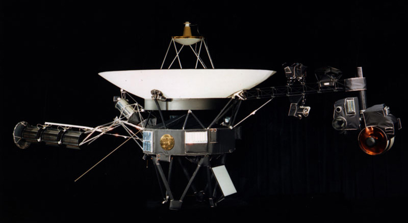
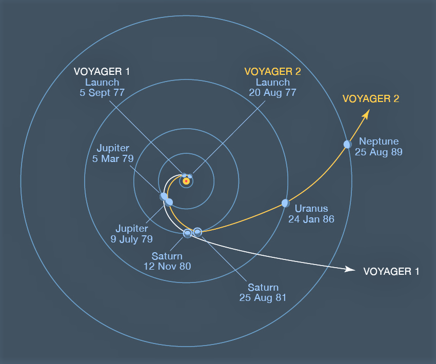
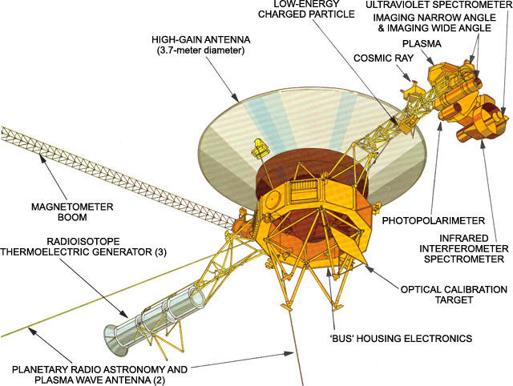
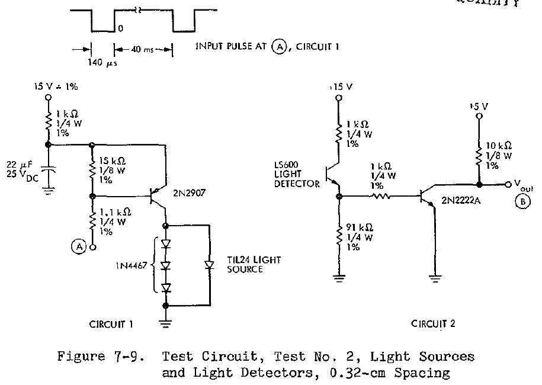
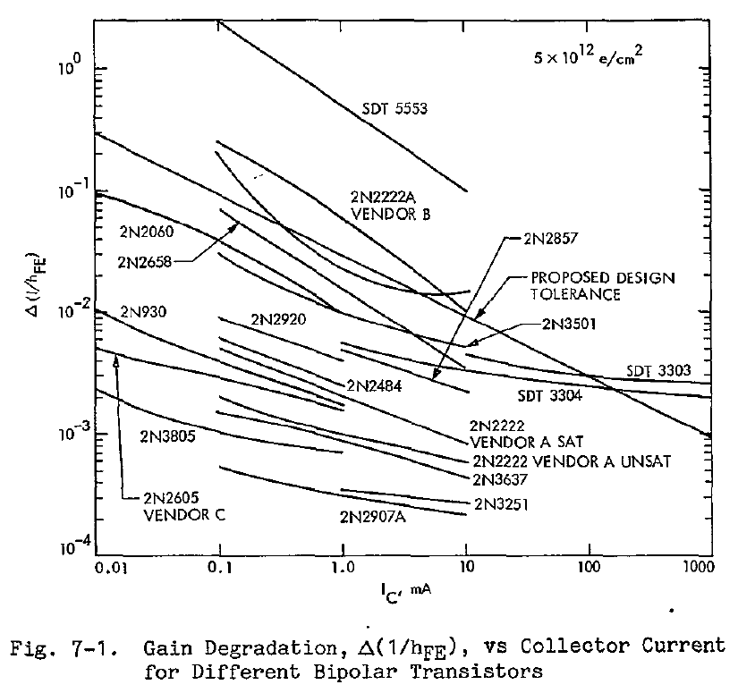
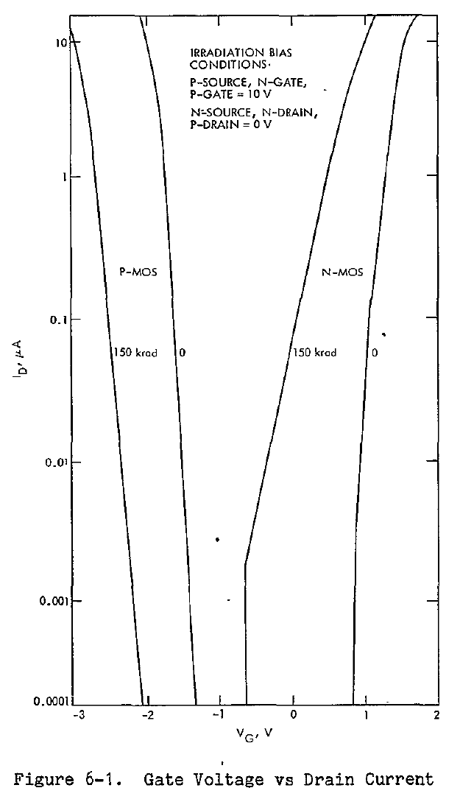
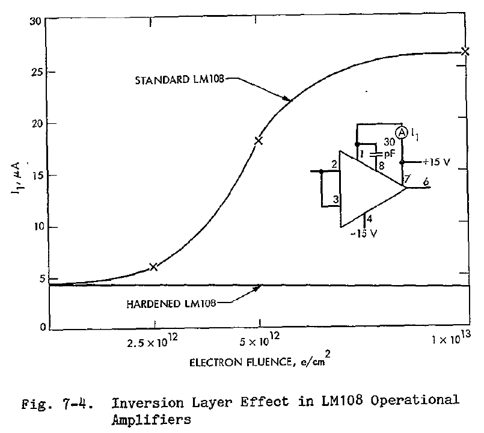
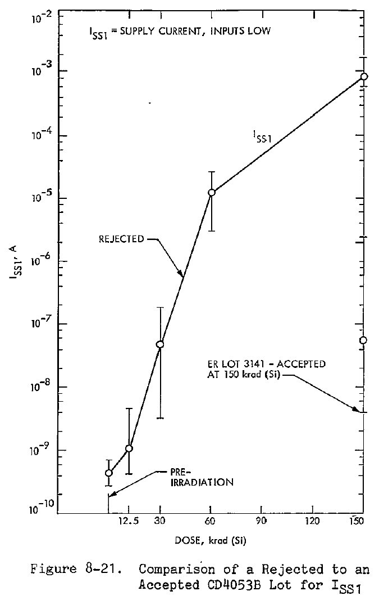
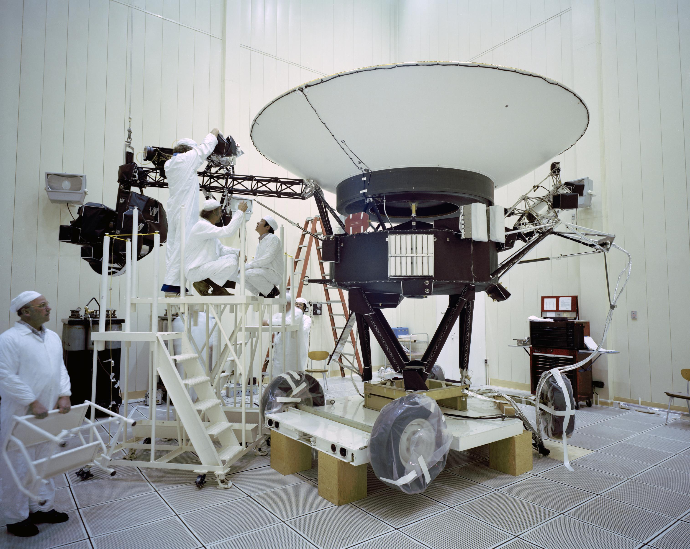

# Voyager: radiación y decisiones electrónicas

Ignacio Cavicchioli · Versión 3 · 16/10/2026

Lectura explicada del informe JPL 77-41, volumen I. Los capítulos siguen las 18 diapositivas. La historia y las distancias se completan con fuentes NASA identificadas; el desarrollo de radiación, hardening y screening procede del informe.

## Recorrido

1. Voyager: radiación y decisiones electrónicas
2. Dos sondas y un recorrido de décadas
3. Pioneer cambió las prioridades
4. El ambiente exterior y el que llega al circuito
5. Partículas, fotones e ionización
6. Las magnitudes que necesitamos
7. La respuesta del programa
8. Resistencias, capacitores y conexiones
9. Diodos y acoplamientos ópticos
10. Bipolares: ganancia y punto de operación
11. JFET y conmutadores analógicos
12. MOS y CMOS: cambios que se superponen
13. Hardening de la familia CMOS RCA
14. LM108 y LM139: mejoras con contrapartidas
15. Memorias, registros y cuarzo
16. Screening: elegir las piezas de vuelo
17. Blindaje y margen de circuito
18. Las decisiones que dejó el programa

## 01. Voyager: radiación y decisiones electrónicas

**Idea de la diapositiva.** Voyager lleva casi cincuenta años en el espacio. Vamos a recorrer las decisiones del programa de radiación que preparó su electrónica para los encuentros planetarios.

*Figura del capítulo 1. Vista de Voyager · NASA/JPL*

### Un informe como hilo conductor

Este dossier es una lectura explicada de *Voyager Electronic Parts Radiation Program, Volume I: Final Report*, JPL Publication 77-41, de A. G. Stanley, K. E. Martin y W. E. Price, fechado el 15 de septiembre de 1977. El relato técnico se apoya en este documento: sus problemas, resultados, decisiones y límites. El orden se adapta a una exposición de electrónica de dieciocho minutos, por lo que no reproduce el índice original. [JPL, portada y §I, p. 1-1 / PDF 24]

El informe presenta la caracterización de aproximadamente doscientos tipos de dispositivos, más de doscientos treinta ensayos de selección de circuitos integrados y transistores, y más de trece mil dispositivos CMOS sometidos a screening. Estos números describen la escala del programa, no la cantidad de componentes instalados en una sonda. Tampoco significan que se ensayara cada componente de cada familia.

La cadena de explicación será siempre la misma: qué ambiente consideraron, qué parámetro podía cambiar, qué consecuencia tenía para el circuito y qué hicieron para conservar su funcionamiento. El ejemplo óptico del capítulo 9 muestra por qué conviene mantener esa cadena: una salida puede seguir siendo correcta aunque los dispositivos que la producen hayan perdido prestaciones.

### Qué permite concluir este documento

El informe registra trabajo anterior a los encuentros con Júpiter. En consecuencia, documenta preparación, capacidades y requisitos; no contiene una investigación retrospectiva de cinco décadas de operación. La antigüedad actual de Voyager permite formular la pregunta de la charla, pero no prueba que todos sus fallos hayan sido radiativos ni que este programa explique por sí solo su longevidad. La energía disponible, el control térmico, las comunicaciones y las operaciones también intervienen.

Las páginas se citan con dos numeraciones: primero la impresa, como 6-1; después la posición en el PDF, como 81. Esta distinción permite encontrar el pasaje aun cuando el visor cuente las portadas. Las explicaciones físicas elementales y los cálculos didácticos se distinguen de los resultados medidos. Un gráfico del banco de ensayos se identifica como tal y no se presenta como el esquema de una placa de vuelo.

### Dónde encontrarlo

§I, p. 1-1 / PDF 24; portada y ficha bibliográfica.

## 02. Dos sondas y un recorrido de décadas

**Idea de la diapositiva.** Voyager 2 despegó el 20 de agosto de 1977 y Voyager 1 el 5 de septiembre. Ambas visitaron Júpiter y Saturno; Voyager 2 continuó hacia Urano y Neptuno.

*Figura del capítulo 2. Trayectorias históricas · NASA. No muestra posiciones actuales.*

### Desarrollo, lanzamientos y encuentros

NASA aprobó el proyecto en 1972; los lanzamientos ocurrieron en 1977. Es razonable hablar de unos cinco años entre aprobación y lanzamiento, aclarando que hubo estudios y propuestas anteriores. La experiencia Mariner y el trabajo previo de exploración planetaria forman parte del contexto, sin convertir esos cinco años en toda la historia de desarrollo. [H1]

| Sonda | Lanzamiento | Planetas visitados |
|---|---|---|
| Voyager 1 | 5 de septiembre de 1977 | Júpiter, 1979; Saturno, 1980 |
| Voyager 2 | 20 de agosto de 1977 | Júpiter, 1979; Saturno, 1981; Urano, 1986; Neptuno, 1989 |

Al 16 de octubre de 2026, Voyager 1 lleva 49 años y 41 días desde el lanzamiento, y Voyager 2, 49 años y 57 días. Faltan respectivamente 324 y 308 días para sus cincuentenarios. Es un cálculo de calendario a partir de las fechas de lanzamiento, no una afirmación de que todas sus funciones continúen intactas.

### Distancia y posición: mantener la fecha

El comunicado NASA del 5 de marzo de 2025 sitúa a Voyager 1 a más de 25.000 millones de kilómetros de la Tierra y a Voyager 2 a más de 21.000 millones. Usamos esos valores con su fecha porque permiten mostrar la escala sin inventar posiciones exactas al día de la presentación. Son distancias a la Tierra, no distancias al Sol ni la longitud total de las trayectorias recorridas. [H2]

Voyager 1 cruzó la heliopausa en 2012 y Voyager 2 en 2018. La heliopausa delimita la región dominada por el viento solar frente al medio interestelar; no marca el fin de la gravedad del Sol. Decir que están en espacio interestelar no implica que hayan atravesado todos los límites posibles del sistema solar. [H1; H2]

### Qué representa el mapa

El mapa de trayectorias permite asociar cada nave con sus encuentros planetarios. Las asistencias gravitatorias modificaron sus recorridos y permitieron destinos diferentes. No conviene leer el dibujo como un plano a escala de las posiciones actuales. La extensión hacia Urano, Neptuno y el medio interestelar es contexto histórico; el modelo de radiación que estudiaremos a continuación es el del programa descrito en 1977.

### Dónde encontrarlo

H1: historia NASA; H2: comunicado de 05/03/2025.

## 03. Pioneer cambió las prioridades

**Idea de la diapositiva.** Según el informe, la radiación inicialmente no se consideraba un problema para Voyager. Las mediciones de Pioneer en Júpiter impulsaron un programa intensivo para revisar circuitos que ya estaban diseñados.

*Figura del capítulo 3. Cinturones internos de Júpiter · imagen de contexto NASA/JPL, posterior al informe.*

### La situación que describe el JPL

La introducción del informe señala que Pioneer había medido campos intensos de electrones y protones atrapados en el campo magnético de Júpiter. Más adelante, al abrir la sección de hardening, afirma que inicialmente la radiación no se había considerado un problema para Voyager y que los sobrevuelos Pioneer impulsaron un esfuerzo intensivo sobre el diseño Mariner existente. Ambas afirmaciones deben leerse juntas: se conocía la radiación espacial, pero su impacto sobre este diseño exigió una revisión específica. [JPL, §I, p. 1-1 / PDF 24; §VI.A, p. 6-1 / PDF 81]

La mayoría de los circuitos ya estaba diseñada cuando se comprendió la necesidad de considerar ese ambiente. La primera acción fue analizar esos diseños usando datos disponibles, y luego reemplazar o completar esos datos con caracterizaciones representativas del ambiente de Júpiter. La respuesta no consistió en fabricar de nuevo toda la nave: incluyó sustitución de piezas, rediseños, procesos especiales, screening y blindaje localizado. [JPL, §III.A, pp. 3-1 a 3-2 / PDF 29-30]

### Por qué importa la restricción de tiempo

El documento explica que no hubo tiempo suficiente para emprender un programa amplio de modificación de todos los dispositivos. Los esfuerzos de fabricación se concentraron en familias CMOS y determinados circuitos lineales. En otras aplicaciones, los diseños y las piezas disponibles ya estaban fijados y hubo que reducir la exposición mediante blindaje. Por eso una solución técnicamente posible no siempre era una solución disponible dentro del calendario del proyecto. [JPL, §VI.A; §IX.A, p. 9-1 / PDF 204]

### Radiación junto a los otros requisitos

El análisis de peor caso incluía temperatura, tolerancias, envejecimiento, alimentación y frecuencia, además de efectos mecánicos o del vacío cuando alteraban parámetros. A esa combinación se agregó la degradación radiativa. Una placa podía superar las comprobaciones de otros ambientes y aun así perder ganancia, precisión o margen lógico en Júpiter. No hace falta que un componente se rompa físicamente para que su circuito deje de cumplir su función. [JPL, §III.B, pp. 3-3 a 3-4 / PDF 31-32]

### Dónde encontrarlo

§I; §III.A-B; §VI.A, p. 6-1 / PDF 81; §IX.A.

## 04. El ambiente exterior y el que llega al circuito

**Idea de la diapositiva.** El programa consideró radiación solar, cósmica y atrapada, además de las fuentes radiactivas a bordo. Dentro de la nave, identificó a los electrones penetrantes de Júpiter como el aporte dominante al daño por ionización.

### Las poblaciones que enumera el informe

La sección II exige funcionamiento durante y después de la exposición a los cinturones terrestres y jovianos, grandes eventos de protones solares, protones del viento solar, radiación cósmica galáctica y radiación de RTG y RHU. Los RHU son pequeñas unidades calefactoras de radioisótopos; los RTG suministran energía térmica para producir electricidad. Ambos fueron considerados como fuentes locales. [JPL, §II.A-C, p. 2-1 / PDF 25]

| Situación | Poblaciones incluidas en el informe | Consecuencia para el relato |
|---|---|---|
| Crucero y exposición solar | Protones solares, viento solar y radiación cósmica | La exposición no empieza al llegar a un planeta |
| Cinturones de la Tierra y Júpiter | Electrones y protones atrapados | El encuentro joviano concentra el problema estudiado |
| Fuentes a bordo | Neutrones y gamma de RTG/RHU | La geometría de la nave y la ubicación importan |

El modelo joviano se construyó con resultados de experimentos de partículas de Pioneer 10 y 11 y con integraciones a lo largo de trayectorias de encuentro. No describe simplemente una intensidad universal a cierta distancia del Sol. La tabla 2-1 presenta el ambiente exterior sin blindaje y sin márgenes; sus valores no son dosis ya recibidas por todos los chips. Para RTG/RHU, el informe explicita integraciones de cuatro años. Extenderlas directamente a medio siglo cambiaría el problema. [JPL, tabla 2-1, p. 2-2 / PDF 26]

### Qué cambia al entrar en la nave

La estructura modifica el espectro que llega a una pieza: algunas partículas se frenan, otras penetran y se producen secundarios. El cálculo de transporte del programa incluyó electrones, protones y bremsstrahlung, los fotones emitidos durante el frenado de electrones. Por eso el blindaje se evaluó junto con la posición y la geometría, no como una reducción idéntica para todos los componentes. [JPL, §III.C, p. 3-6 / PDF 34]

Para el ambiente interno considerado, el informe dice que dominan los electrones penetrantes y sus efectos de ionización superficial en semiconductores. Considera pequeña la contribución electrónica al daño por desplazamiento y suficientes las protecciones/exposiciones para que protones y neutrones no produzcan un daño por desplazamiento significativo en ese contexto. El aporte gamma de RTG/RHU resulta mucho menor que el electrónico. Esta comparación explica por qué el dossier se concentra en óxidos, interfaces, fugas y cambios de parámetros. [JPL, §II.D, p. 2-3 / PDF 27]

El impacto de polvo, la temperatura y el vacío delimitan el contexto, pero el informe no permite asignar una probabilidad universalmente despreciable a impactos ni concluir que todos serían catastróficos. La charla se restringe al programa de radiación por su tema y duración.

### Dónde encontrarlo

§II, pp. 2-1 a 2-4 / PDF 25-28; §III.C, p. 3-6 / PDF 34.

## 05. Partículas, fotones e ionización

**Idea de la diapositiva.** La fuente indica de dónde viene la radiación; la especie indica qué llega. En el material, esa energía puede generar portadores eléctricos o defectos que cambian el comportamiento del componente.

### Fuente y especie no son sinónimos

Júpiter es un lugar y una magnetósfera; electrón es una especie. RTG es una fuente; neutrón y gamma son los componentes del campo que el informe modela fuera de ella. Un protón puede proceder del viento solar, de un episodio solar energético o de una población atrapada. Las etiquetas de procedencia no reemplazan la descripción de la energía y del tipo de partícula. [JPL, §II.A-C]

Como vocabulario físico: un protón tiene carga positiva; un electrón, negativa; un neutrón no tiene carga neta; un fotón transporta energía electromagnética y tampoco tiene carga. Alfa designa un núcleo de helio-4 y beta, electrones o positrones de desintegración beta. Gamma designa fotones de origen nuclear; los rayos X también son fotones, asociados a otros procesos. Esta clasificación elemental ayuda a leer la tabla 2-1; no significa que el informe atribuya la misma importancia a todas las especies.

Los rayos cósmicos no deben presentarse como sinónimo de rayos gamma. El informe incluye radiación cósmica galáctica sin desarrollar una composición completa para una charla de física de partículas. Tampoco necesitamos atribuir a una eyección solar una especie o energía única: mantendremos las poblaciones solares que enumera el documento.

### Ionización y defectos

Ionizar consiste en transferir energía capaz de liberar cargas ligadas. En un semiconductor se pueden generar electrones y huecos móviles; un campo eléctrico puede separarlos y originar una corriente. En un aislante, parte de la carga puede quedar atrapada. Un estado de interfaz es un estado electrónico asociado a la frontera entre materiales, capaz de intercambiar carga con el semiconductor. Esas cargas cambian campos y condiciones eléctricas, aun sin producir una rotura visible. [JPL, §III.D; §VI.B]

El desplazamiento atómico es otro mecanismo: una interacción transfiere suficiente energía a un átomo para sacarlo de su posición y dejar defectos. El informe no le asigna el papel dominante en la electrónica interna de este programa. En los capítulos de bipolares y JFET, la explicación principal seguirá la ionización superficial documentada, en lugar de atribuir automáticamente toda pérdida de prestaciones a una red cristalina dañada. [JPL, §II.D; §IV.A.2; §VII.B-C]

### Durante la exposición y después

Una corriente generada mientras llega radiación puede interferir con una medida sin dejar el mismo cambio permanente que una carga atrapada. El informe separa esos efectos de interferencia, dependientes de la tasa de ionización, de la degradación acumulada. Esa distinción será útil para los detectores y para no mezclar un pulso, una fuga sostenida y una pérdida de margen. [JPL, §III.D, pp. 3-7 a 3-8 / PDF 35-36]

### Dónde encontrarlo

§II; §III.D, pp. 3-7 a 3-8 / PDF 35-36; §VI.B, p. 6-2 / PDF 82.

## 06. Las magnitudes que necesitamos

**Idea de la diapositiva.** El tipo y la energía ayudan a entender la interacción con el material. El flujo describe cuántas partículas llegan por área y tiempo; la dosis expresa cuánta energía absorbe una masa de material.

### Cuatro características y una distinción necesaria

El tipo de radiación identifica el agente; la energía, habitualmente expresada en eV, keV o MeV, caracteriza su capacidad de transferir energía en una interacción. El flujo expresa una tasa de llegada por área y tiempo, por ejemplo electrones/(cm²·s). La fluencia suma esas llegadas por área durante un intervalo, en electrones/cm². La dosis absorbida expresa energía depositada por masa. El informe utiliza estas magnitudes en las tablas 2-1, 2-2 y 5-3. [JPL, pp. 2-2, 2-4 y 5-4 / PDF 26, 28 y 64]

Si φ representa el flujo y es constante durante t, la fluencia es Φ = φ·t. Por ejemplo, 10⁸ electrones/(cm²·s) durante 100 s producen 10¹⁰ electrones/cm². Este cálculo cuenta partículas; no determina por sí solo la dosis.

La dosis es D = E_abs/m. Un gray equivale a 1 J/kg; un rad equivale a 0,01 Gy. Por tanto, 30 krad(Si) equivalen a 300 Gy(Si), o 300 J/kg absorbidos en silicio. Es una traducción de unidades, no una temperatura, una cantidad de radiografías ni una dosis biológica comparable automáticamente con un ser humano. La sensibilidad eléctrica puede estar concentrada en un volumen muy pequeño y en una interfaz crítica.

### Energía, penetración y blindaje

Para una misma especie y material, aumentar la energía puede aumentar el alcance, pero la pérdida de energía depende del mecanismo de interacción. Un fotón no tiene un alcance final único como en una imagen simplificada de una partícula cargada: su transmisión se describe probabilísticamente. No se puede ordenar toda la radiación por penetración usando solo el número de MeV.

El mecanismo relevante para atravesar la estructura de una nave es transporte, dispersión y pérdida de energía, con posibles secundarios. No conviene explicarlo como túnel cuántico a través de un aislante de un dispositivo. El informe calculó atenuación y transporte para electrones, protones y bremsstrahlung. [JPL, §III.C.2]

### Qué conserva el dossier de los ensayos

Los valores de fluencia y dosis de las tablas de ensayo están relacionados por las condiciones de esa campaña. No usaremos una conversión universal de electrones/cm² a krad. Para efectos transitorios también interesa la tasa de dosis, porque una corriente de interferencia puede depender de la energía depositada por unidad de tiempo. En CMOS el propio informe discute además tasa de dosis y recocido; por eso no generalizamos que una misma dosis produzca siempre exactamente el mismo resultado, independientemente de su historia temporal. [JPL, §III.D; §VII.F.3, pp. 7-45 y 7-49 / PDF 143 y 147]

### Dónde encontrarlo

Tablas 2-1, 2-2 y 5-3; §III.C-D; §VII.F.3.

## 07. La respuesta del programa

**Idea de la diapositiva.** Voyager necesitaba circuitos que siguieran dentro de sus límites después de degradarse. El programa combinó sustitución de piezas, rediseño, fabricación modificada, selección y blindaje según cada aplicación.

*Figura del capítulo 7. Ubicación de instrumentos · NASA. Vista de contexto, no inventario de piezas.*

### Dónde aparecen las familias de componentes

La alimentación y sus reguladores emplean semiconductores y pasivos; los instrumentos añaden detectores, amplificación, referencias y conversión; la lógica de control y de datos emplea circuitos digitales y memoria. Como contexto arquitectónico, Voyager distribuye funciones entre CCS, AACS y FDS, y dispone de grabación en cinta. La evolución del FDS hacia procesamiento y memoria CMOS se documenta en la historia de computación de NASA, usada aquí exclusivamente para ubicar las funciones. [H3, pp. 181-184]

La memoria magnética, la cinta y la memoria CMOS almacenan información mediante mecanismos diferentes. Ese contexto no permite adjudicar a cada placa una familia lógica o una lista de componentes sin documentación. El informe sí identifica familias y, en algunos casos, aplicaciones o partes de vuelo. Por ejemplo, su §VII.K informa ensayos de lógica Texas Instruments 54L, mientras que §VI.B describe el uso abundante de CMOS con veintiocho funciones lógicas.

### La prioridad de soluciones

El documento enumera como prioridad de respuesta el reemplazo directo por otras piezas de la lista, el rediseño del circuito, las piezas endurecidas mediante procesos especiales y screening, y la adición de masa de blindaje. No significa que cada componente recorriera obligatoriamente esas cuatro etapas: el calendario, la exposición y la función determinaban la combinación posible. [JPL, §III.A, p. 3-2 / PDF 30]

Caracterizar un tipo consiste en establecer cómo varían sus parámetros bajo condiciones pertinentes. Endurecer un dispositivo consiste en modificar su diseño o fabricación para mejorar su respuesta. El screening selecciona material o piezas conforme a criterios de aceptación. El análisis de circuito decide qué valores son tolerables y el blindaje reduce la exposición local. Ninguna de estas tareas reemplaza automáticamente a las demás.

### Qué significa que una pieza sea apta

El programa distinguió piezas insensibles en el ámbito estudiado, piezas adecuadas salvo para aplicaciones muy exigentes, piezas sensibles que requerían medidas y piezas que sufrían cambios catastróficos. El criterio era funcional: pequeñas derivas pueden importar en una medida precisa y ser tolerables en otra función. El reporte señala especialmente aplicaciones de corrientes muy bajas, tensiones muy altas o gran precisión. [JPL, §IV.A.2-3, pp. 4-3 a 4-4 / PDF 39-40]

Al estudiar cada familia preguntaremos qué parámetro cambió y qué exigía su aplicación. Esto también incluye los encapsulados: en determinados amplificadores, el proceso de sellado alteró la respuesta radiativa. La pieza completa y su procedencia importaban tanto como la etiqueta comercial. [JPL, §IV.B.5, p. 4-24 / PDF 60]

### Dónde encontrarlo

§III.A; §IV.A.2-3; §IV.B.5; §VI.B; §VII.K. H3 solo para arquitectura.

## 08. Resistencias, capacitores y conexiones

**Idea de la diapositiva.** Los pasivos ensayados mostraron cambios pequeños en resistencia y capacitancia. Esos resultados permitían concentrar el esfuerzo en dispositivos más sensibles, sin convertir a todos los materiales y aislantes en inmunes.

### Resistencias: qué se midió

Los tipos Dale Electronics CDP16, CDP18, LDP16 y SDP16, de película metálica, fueron irradiados a 10¹³ electrones/cm². No se observó cambio de resistencia dentro del error experimental de ±0,01 %. El resultado es sólido en su alcance: estabilidad de ese parámetro, para esos tipos y esa exposición. No demuestra la composición de todas las resistencias de vuelo ni revela por sí solo el motivo de selección de cada referencia. [JPL, §VII.H.2, p. 7-53 / PDF 151]

Como explicación de circuito, R fija una relación entre tensión y corriente; en un divisor, una deriva desigual entre resistencias cambia la relación de división. Un conductor puede evacuar carga móvil, pero eso no hace irrelevantes sus superficies, el sustrato, el encapsulado o el aislamiento entre terminales. El informe no proporciona aquí una medida completa de fuga de esas redes resistivas durante la irradiación. Conviene no sustituir el resultado medido por una explicación universal de inmunidad.

### Capacitores: cambios pequeños, con cifras concretas

Se ensayaron seis capacitores de cada valor de Component Research B11B de teflón: 0,02 y 0,05 µF. Tras 5 × 10¹² electrones/cm², las disminuciones medias de capacitancia fueron 5 y 12 pF. Las variaciones relativas calculadas son 5/20.000 = 0,025 % y 12/50.000 = 0,024 %. Son promedios de la muestra, no máximos garantizados para todo capacitor. [JPL, §VII.H.1, p. 7-53 / PDF 151]

| Componente del ensayo | Resultado comunicado | Límite de interpretación |
|---|---|---|
| Redes Dale de película metálica | Sin cambio detectable de R dentro de ±0,01 % | A 10¹³ electrones/cm²; no caracteriza todos los aislantes |
| B11B de 0,02 µF | Disminución media de 5 pF | Seis unidades; 5 × 10¹² electrones/cm² |
| B11B de 0,05 µF | Disminución media de 12 pF | Seis unidades; 5 × 10¹² electrones/cm² |

En el modelo elemental C = εA/d, variar la permitividad puede variar C, pero no toda carga atrapada produce una variación simple de ε. También pueden importar conducción del dieléctrico, pérdidas y corrientes de fuga. Un modelo R_fuga en paralelo con C da una retención caracterizada por τ = R_fuga·C; permite entender que mantener la capacitancia no verifica automáticamente el aislamiento. Esta es una explicación de circuito, no un efecto adicional medido en los B11B por ese apartado.

### Inductores, transformadores, relés y materiales

Inductores y transformadores incluyen bobinados y aislamiento; un transformador añade aislamiento entre circuitos. Los relés incluyen bobina y contactos, y las pistas, soldaduras y conectores conducen las señales. Los encapsulados y soportes sostienen y aíslan las piezas. El volumen I no ofrece una sección de resultados comparable a §VII.H para atribuir materiales, modelos y soluciones radiativas a todas esas familias de vuelo.

La ausencia de ese desarrollo se declara en la presentación. Las fotografías y esquemas de ensayo pueden mostrar resistencias, capacitores o relés del banco de laboratorio: su presencia no demuestra que esos elementos formaran parte de una placa enviada al espacio. La conclusión práctica del capítulo es que el programa encontró una sensibilidad muy distinta según la familia y la aplicación; no todo exigía el mismo esfuerzo de modificación.

### Dónde encontrarlo

§VII.H, p. 7-53 / PDF 151. Cálculos porcentuales y modelos RC: explicación didáctica.

## 09. Diodos y acoplamientos ópticos

**Idea de la diapositiva.** Los diodos ensayados podían conservar parámetros adecuados mientras ciertos emisores y detectores ópticos se degradaban mucho. En un circuito del informe, la señal restante todavía alcanzaba para mantener una salida correcta.

*Figura del capítulo 9. Figura 7-9 del informe: circuito de ensayo óptico, no esquema de una placa de vuelo.*

### Diodos: distinguir la función

Para los diodos y rectificadores 1N4148, 1N5711, BC997-1, FJT1100, MV1404 y UTR4320, el informe describe cambios típicos de fuga menores que 1 nA y variaciones de tensión directa de pocos milivoltios después de 10¹³ electrones/cm². Los considera resistentes en ese contexto. Los Zener y referencias se estudiaron aparte porque una deriva pequeña de tensión puede ser relevante para una función de precisión. [JPL, §VII.G, pp. 7-49 a 7-53 / PDF 147-151]

El documento encontró en determinados Zener cambios dependientes de energía que atribuyó a daño en volumen, y en algunas unidades anomalías que interpretó como efectos superficiales. No todos los cambios tenían el mismo signo. Conviene mantener esa distinción sin trasladar las variaciones de una referencia a todas las uniones semiconductoras.

### Un caso concreto: la señal óptica y la salida eléctrica

El ensayo óptico con TIL24 y LS600, separados aproximadamente 0,32 cm, aplicó fluencias de 5 × 10¹² y 10¹³ electrones/cm². No observó un cambio significativo de la salida medida. Los autores razonaron, a partir de experiencias previas, que los dispositivos debían estar degradados, pero todavía entregaban suficiente señal pulsada para accionar el 2N2222A de la salida. Es importante conservar esa diferencia: la salida se midió; la degradación interna de ese ensayo se infirió apoyándose en otros resultados. [JPL, §VII.I.1.a, p. 7-55 / PDF 153; figura 7-9, p. 7-57 / PDF 155]

La figura muestra un circuito de ensayo y permite seguir la cadena emisor luminoso, detector, excitación del transistor y salida. El circuito final introduce una respuesta de conmutación: mientras la excitación supere lo necesario, una reducción considerable de la señal óptica puede no verse como una reducción proporcional del nivel de salida. Es un ejemplo de margen funcional, no una prueba de ausencia de daño.

Los ensayos separados de fuentes y detectores y las conclusiones de §VII.I señalaron sensibilidad radiativa importante, mayor en las fuentes estudiadas que en los detectores. También señalaron dispersión de luz asociada a la lente degradada. En la geometría de mayor separación, perder o dispersar luz tenía consecuencias más visibles. No extrapolaremos un porcentaje único de degradación a todos los LED u optoacopladores. [JPL, pp. 7-57 a 7-61 / PDF 155-159]

### Interferencia y mitigación

Durante la exposición, la ionización también puede generar fotocorrientes o fluorescencia que se confundan con una señal. El informe menciona como respuestas usar menor área de juntura para reducir fotocorriente, materiales ópticos de elevada pureza y, cuando corresponda, filtros o blindaje. Son técnicas discutidas por el programa; la lista no prueba su aplicación en cada instrumento. [JPL, §III.D, pp. 3-7 a 3-8 / PDF 35-36]

### Dónde encontrarlo

§VII.G; §VII.I, pp. 7-54 a 7-61 / PDF 152-159; figura 7-9.

## 10. Bipolares: ganancia y punto de operación

**Idea de la diapositiva.** En los bipolares, el informe relaciona la degradación con un aumento de la corriente de base y de las fugas. La pérdida de ganancia era especialmente importante a bajas corrientes y dependía del fabricante y del proceso.

*Figura del capítulo 10. Figura 7-1: cambio de ganancia inversa frente a corriente. La dosis y el fabricante condicionan la comparación.*

### La explicación que privilegia el informe

El §VII.B atribuye la degradación en ambiente ionizante al aumento de corriente de base y señala que es más fuerte a corrientes bajas. En algunos dispositivos, capas de inversión cerca de regiones superficiales tipo p aumentaban especialmente las fugas de juntura. Así, el caso Voyager no se explica adecuadamente reduciendo todo a átomos desplazados dentro de la base: el propio informe destaca el estado de las superficies y su fabricación. [JPL, p. 7-2 / PDF 100]

Una carga retenida en un óxido puede modificar el potencial de la superficie próxima. La región superficial puede dejar de comportarse como antes y abrir un camino de conducción no previsto. Los procesos de generación y recombinación superficiales también alteran las corrientes de juntura. A corriente de colector fijada, un aumento de corriente de base reduce β = I_C/I_B. La consecuencia a tensión de base fija depende del resto del circuito; no debe inferirse aplicando mecánicamente la misma frase a cualquier polarización.

### El ejemplo numérico del documento

La tabla 7-1 expresa cambios mediante Δ(1/β), y el texto muestra cómo recuperar la ganancia final: β_final = 1 / [1/β_inicial + Δ(1/β)]. Para el TI 2N2605 a I_C = 0,01 mA se usa Δ(1/β) = 0,003 a 5 × 10¹² electrones/cm². Si β_inicial = 100, entonces β_final = 1/(0,01 + 0,003) ≈ 76,9. La ganancia inicial de cien es el supuesto del ejemplo, no una medición universal de todas esas piezas. [JPL, p. 7-9 / PDF 107]

Como consecuencia didáctica, para sostener 10 µA de colector, la corriente de base pasa de 0,10 a aproximadamente 0,13 µA. La diferencia parece pequeña, pero puede importar en una etapa diseñada con consumos bajos o márgenes estrechos. Para un transistor de conmutación debe revisarse además la capacidad de su excitador y el estado de saturación; no basta con una ganancia medida en otra condición.

### Qué hicieron frente a la variación

La figura 7-1 compara dispositivos y fabricantes; incluso una misma referencia 2N2222 presentaba respuestas muy diferentes según la línea de producción. El programa usó selección de lotes, revisión del circuito, elección de ganancias iniciales adecuadas y blindaje donde resultaba necesario. El capítulo de conclusiones recomienda operar cerca del punto de máxima ganancia y diseñar tolerando parámetros degradados. Esa recomendación se presenta como tal, sin afirmar que todos los circuitos de Voyager se rediseñaran para cumplirla. [JPL, §III.A; §IX.B, p. 9-2 / PDF 205]

Los *outliers* eran unidades con una respuesta mucho peor que la población de referencia. La importancia para la charla no es calcular una distribución estadística: es entender por qué el valor típico de una hoja de datos no garantizaba el funcionamiento de todas las unidades que iban a comprarse. El screening del capítulo 16 responde a ese problema.

### Dónde encontrarlo

§VII.B y C, pp. 7-2 a 7-9 / PDF 100-107; figura 7-1; §IX.B.

## 11. JFET y conmutadores analógicos

**Idea de la diapositiva.** Los JFET podían desarrollar fugas por efectos en su superficie, aunque su compuerta no fuera un óxido MOS. En los conmutadores analógicos también importaba el circuito que controlaba al transistor de paso.

### Por qué un JFET también tiene un problema de superficie

En un JFET, la juntura de compuerta controla la sección conductora mediante su región de agotamiento. No es la compuerta aislada de un MOSFET, pero la fabricación todavía incluye superficies y pasivación. El informe identifica a los JFET de canal n poco dopado como especialmente propensos a formación de capas de inversión y a aumentos de fuga compuerta-fuente, I_GSS. También describe conducción no deseada a través del sustrato. [JPL, §VII.C, p. 7-9 / PDF 107]

La carga superficial puede modificar la distribución de portadores cerca de una región de bajo dopado y crear un camino que antes no conducía de la misma manera. El aumento de fuga puede perturbar una entrada sensible, aunque el canal siga respondiendo a su compuerta. Como modelo de circuito, una fuga que circula por una impedancia R genera un error aproximado I_fuga·R: cuanto mayor sea la impedancia, más importa esa corriente. Es una explicación general del resultado, no un valor medido en una entrada específica de Voyager.

### El conmutador contiene más que el elemento de paso

El informe describe DG129, DG133 y DG141 con un controlador bipolar y JFET de canal n como interruptores. El DG181 también usa JFET de paso, pero su controlador combina dispositivos bipolares y MOS. Por eso «contiene MOS» y «el interruptor es MOS» no son afirmaciones equivalentes. La sensibilidad del controlador puede limitar el conjunto. [JPL, §IX.C.4, p. 9-3 / PDF 206]

Los parámetros relevantes incluyen corriente de fuga en apagado, resistencia en conducción y comportamiento dinámico. En una adquisición analógica, una fuga puede alterar el valor medido; un aumento de resistencia de paso puede aumentar el error bajo carga o retrasar el establecimiento de la señal. El informe informa variaciones muy dependientes de la polarización durante la exposición, del fabricante y del lote. [JPL, §VII.E, pp. 7-42 a 7-44 / PDF 140-142]

### Las decisiones efectivamente documentadas

La selección de lotes JFET distinguió respuestas uniformemente buenas, uniformemente sensibles y mezcladas. En las mezcladas tenía sentido separar unidades; cuando todo el lote era demasiado sensible, el screening no podía producir piezas resistentes por selección. Algunas aplicaciones requirieron blindaje. [JPL, §VIII.D, pp. 8-15 a 8-16 / PDF 176-177]

El DGM111 proporciona otro caso de decisión a nivel circuito: el informe señala que pudo utilizarse en una aplicación cuyas polarizaciones minimizaban la degradación, y da drenador a +10 V, fuente a tierra y alimentación lógica a +5 V. No es una receta universal, sino evidencia de que las tensiones durante la exposición eran parte de la solución. [JPL, §VIII.B.1, p. 8-7 / PDF 168]

### Dónde encontrarlo

§VII.C y E; §VIII.B.1 y D; §IX.C.4.

## 12. MOS y CMOS: cambios que se superponen

**Idea de la diapositiva.** La carga en el óxido y los estados de interfaz pueden desplazar el umbral en sentidos diferentes. En ciertos MOS de canal n, el informe describe una recuperación parcial del umbral a dosis mayores, sin que eso garantice una mejora del circuito.

*Figura del capítulo 12. Figura 6-1: corriente de drenador frente a tensión de compuerta, antes y después de irradiar.*

### Qué controla el umbral

Un MOSFET controla la región conductora mediante el campo a través de un aislante. La tensión umbral V_T describe una condición de formación del canal, con un criterio de medida que debe especificarse. CMOS combina transistores MOS complementarios, de canal n y p. MOSFET designa un dispositivo; CMOS describe una manera de construir circuitos con ambos tipos. Esa distinción evita confundir tecnología de transistor, familia lógica y función del integrado.

La ionización puede dejar carga atrapada en el óxido y alterar estados de la interfaz silicio-óxido. La carga modifica el campo que, antes de la exposición, dependía de la tensión aplicada y de las cargas originales de la estructura. Una aproximación electrostática para la contribución de carga positiva de óxido es ΔV_T,ox ≈ -Q_ot/C_ox, usando magnitudes por unidad de área. Es una ayuda didáctica para el signo; no calcula por sí sola el cambio total ni sustituye las curvas del lote. [JPL, §VI.B, pp. 6-1 a 6-2 / PDF 81-82]

### Por qué puede aparecer una recuperación parcial

El informe explica que los estados del óxido producen desplazamientos negativos en ambos tipos de transistor. Para los dispositivos que describe, los estados de interfaz desplazan el umbral n hacia valores más positivos y el p hacia más negativos. La contribución de óxido actúa a dosis bajas y se satura a las mayores; la de interfaz cobra importancia a dosis altas. [JPL, p. 6-2 / PDF 82]

En canal n, esas contribuciones pueden compensarse parcialmente: primero el umbral se aleja del inicial en dirección negativa y después vuelve hacia valores positivos. Es posible ver una mejora parcial de ese parámetro al aumentar la dosis, aun cuando haya más defectos. En canal p, las dos contribuciones descritas desplazan el umbral hacia valores negativos y no producen la misma compensación. Esta explicación pertenece al régimen y a los dispositivos tratados; no fija signos universales para cualquier proceso MOS actual.

### Umbral, corriente y ganancia no son lo mismo

Si el umbral n baja, a igual tensión de compuerta el dispositivo puede conducir más. Eso puede aumentar una fuga en el estado que debería estar apagado, y por lo tanto empeorar el circuito. Una corriente mayor no implica automáticamente mayor ganancia útil. La transconductancia g_m describe la variación de corriente de drenador con tensión de compuerta a condiciones fijadas; la ganancia de tensión también depende de la carga y de otras resistencias. El pasaje de recuperación de §VI.B se refiere al umbral, no demuestra un aumento general de g_m.

La figura 6-1 permite mirar corriente frente a tensión de compuerta para canal n y p antes y después de irradiar. El propio texto advierte que el umbral extraído a corrientes bajas muestra un desplazamiento que puede pasar inadvertido si se observa solo a corrientes más altas. No se debe sustituir esa curva por la frase «el transistor conduce menos siempre».

### La consecuencia en CMOS

El reporte relaciona desplazamientos de umbral con pérdida de conmutación, fuga excesiva, reducción de velocidad y cambios de inmunidad al ruido. Además, sus ensayos no encontraron una correlación útil entre el cambio de corriente de reposo I_SS y el de tiempo de propagación t_p. Medir consumo no bastaba para saber si los tiempos seguían siendo aceptables. Esta es una de las razones para comprobar varios parámetros funcionales, incluso cuando una compuerta todavía da ceros y unos correctos. [JPL, §VII.F.1-2, p. 7-45 / PDF 143]

### Dónde encontrarlo

§VI.B, pp. 6-1 a 6-3 / PDF 81-83, figura 6-1; §VII.F.1-2.

## 13. Hardening de la familia CMOS RCA

**Idea de la diapositiva.** RCA modificó el recocido del óxido de compuerta de 1100 a 950 °C para mejorar la respuesta de la familia CD4000. Los dispositivos podían seguir funcionando después de irradiarse, pero conservaban aumentos de fuga, consumo y retardo.

### El problema y la intervención

El informe señala que la nave empleaba muchos dispositivos CMOS, con veintiocho funciones lógicas distintas. Los fabricados con el proceso comercial estándar no soportaban 5 × 10¹² electrones/cm² bajo condiciones normales de polarización: el umbral del canal n se desplazaba hacia cero y aumentaba la corriente de alimentación. RCA redujo la temperatura de recocido del óxido de compuerta de 1100 a 950 °C y logró piezas que seguían funcionando a esa fluencia, aunque con características degradadas. [JPL, §VI.B, p. 6-1 / PDF 81]

Estas temperaturas pertenecen a la fabricación del semiconductor. No describen su temperatura de operación ni el recocido posterior de componentes encapsulados del programa IRAN. El informe caracteriza el esfuerzo de hardening como empírico; no proporciona una derivación atomística completa que permita afirmar que cualquier óxido mejora simplemente por bajar su temperatura de proceso. [JPL, §IX.C.1, p. 9-2 / PDF 205]

### Lo que seguía cambiando

A 150 krad(Si), el documento informa aumentos muy grandes de corriente de reposo, fugas entre terminales y cambios de umbral, además de aumentos del retardo. Que la corriente inicial sea muy pequeña permite multiplicaciones enormes sin que eso equivalga necesariamente a amperes; aun así, importa su valor final y la capacidad de alimentación de la aplicación. Los dispositivos de gran área y las compuertas de transmisión de multiplexores recibieron atención especial. [JPL, pp. 6-1 a 6-2]

El §VII.F concluye que el proceso de 950 °C parecía adecuado para las condiciones de Voyager que allí describe, incluyendo la dosis prevista y la ausencia de restricciones severas de corriente de reposo. El mismo texto advierte que ambientes mayores o requisitos más estrictos requerirían otro proceso. No aplicaremos los 125 o 150 krad discutidos para determinadas pruebas CMOS como si fueran la dosis de todos los equipos: el margen del bus del capítulo 17 es otro nivel de análisis. [JPL, p. 7-49 / PDF 147]

### Atmósfera de recocido y control de lotes

El informe menciona resultados preliminares favorables al reemplazar forming gas por nitrógeno durante el recocido, y después presenta comparaciones de screening. En los multiplexores evaluados, el cambio redujo problemas de fuga y mejoró la distribución de respuesta. El §VIII.E describe que la selección eliminaba obleas con dispositivos catastróficos o con consumos inaceptables para las aplicaciones. La mejor fabricación no eliminaba la necesidad de verificar lo que realmente se entregaba. [JPL, pp. 8-19 y 8-30 / PDF 180 y 191]

La decisión combina, por lo tanto, un cambio de proceso, aceptación de prestaciones degradadas dentro de límites útiles y control de la producción. No es una elección entre «un chip perfecto» y «uno que se destruye»: hay una región intermedia en la que las funciones continúan, con menor margen y parámetros distintos.

### Dónde encontrarlo

§VI.B, pp. 6-1 a 6-2 / PDF 81-82; §VII.F.4; §VIII.E; §IX.C.1.

## 14. LM108 y LM139: mejoras con contrapartidas

**Idea de la diapositiva.** Los cambios de fabricación mejoraron la resistencia de algunos circuitos lineales, pero también alteraron otras prestaciones. En el LM108 aparecieron problemas de ruido y encapsulado; el LM139 mostró una fuerte dependencia de la polarización.

*Figura del capítulo 14. Figura 7-4: efecto de inversión en LM108 estándar y endurecido; incluye el circuito de comparación.*

### LM108: cambiar el proceso modifica varias prestaciones

Voyager financió a fines de 1974 y principios de 1975 lotes con procesamiento especial en National Semiconductor. El esfuerzo mejoró determinados dispositivos, especialmente LM108, mientras que los intentos de endurecer LM101 y LM111 no fueron exitosos en ese programa. El informe vincula la sensibilidad de circuitos bipolares lineales a ionización superficial y a las condiciones de oxidación, difusión y recocido. [JPL, §VI.C.1, pp. 6-3 a 6-4 / PDF 83-84]

En el LM108 estándar, las corrientes de fuga de estructuras pnp y los efectos de inversión podían perturbar corrientes internas y ganancia. La figura 7-4 compara la respuesta del dispositivo estándar con la del endurecido y muestra el circuito empleado para esa comparación. Sirve para conectar una alteración superficial con un efecto de circuito, sin identificar ese montaje como placa de vuelo. [JPL, §VII.D.1, pp. 7-13 a 7-14 / PDF 111-112]

Los LM108/LM108A modificados resultaron adecuados para aplicaciones de Voyager, pero no conservaron todas las ventajas del producto estándar. El informe menciona dificultad para cumplir consistentemente especificaciones iniciales, bajo rendimiento de fabricación a -55 °C, más ruido y problemas con el encapsulado flatpack. En aplicaciones que necesitaban ese encapsulado o no toleraban el ruido se usaron dispositivos estándar con blindaje importante; otras exigieron blindar incluso piezas endurecidas. [JPL, §VI.C.2, pp. 6-4 a 6-5 / PDF 84-85]

El texto atribuye el ruido del proceso con oxidación por vapor al aumento de estados rápidos de interfaz y a daño de red asociado a ese proceso. No hay contradicción en mejorar tolerancia radiativa y empeorar ruido: son criterios distintos. Para el circuito, una variación de offset produce un error sistemático referido a la entrada; el ruido agrega fluctuaciones. Una aplicación puede tolerar una de esas consecuencias y no la otra.

### LM139: importa cómo se usa y cómo se mide

El hardening del LM139 incluyó cambios en oxidación. El primer intento no dio el resultado buscado y una modificación posterior mejoró la respuesta en las condiciones descritas, aunque con inconvenientes en corriente de salida. El informe también documenta que se usaron versiones endurecidas y estándar: las modificadas llegaron tarde y en cantidades insuficientes. [JPL, §VI.C.3, p. 6-5 / PDF 85; §VII.D.2, p. 7-29 / PDF 127]

La sensibilidad dependía fuertemente del estado y de la alimentación durante la irradiación. El documento contrasta exposición en estado off con otras condiciones y muestra que cambiar la tensión de alimentación cambiaba los resultados. Además, medir corriente de salida con salida a 1,5 V o a 0,7 V modificaba la comparación entre versiones. El reporte especifica que las aplicaciones Voyager requerían el funcionamiento a 0,7 V. Por eso no convertiremos una fila de ensayo en una sentencia universal sobre el LM139. [JPL, §VII.D.2; tablas 7-14 a 7-16]

En este caso, el informe usa *latchup* para un modo de fallo observado bajo irradiación. No lo reinterpretamos automáticamente como el SEL por una sola partícula de un catálogo moderno de efectos. Para explicar este trabajo basta describir el comportamiento anómalo, las condiciones y la mitigación registradas.

### Cómo leer estas comparaciones

Cada afirmación de mejora debe completar cuatro datos: mejora respecto de qué versión, bajo qué polarización, en qué parámetro y con qué compromiso en otras prestaciones. No existe un rótulo «rad-hard» que permita ignorar las condiciones del circuito. Esa es la enseñanza común de estos dos casos.

### Dónde encontrarlo

§VI.C.1-3, pp. 6-3 a 6-5 / PDF 83-85; §VII.D.1-2; figura 7-4.

## 15. Memorias, registros y cuarzo

**Idea de la diapositiva.** La memoria CMOS sensible recibió protección específica para limitar su dosis. En los cristales de cuarzo, el programa seleccionó material mediante muestras antes de fabricar las unidades de vuelo.

### Memoria y estados lógicos

El informe dice que se usó una RAM estática CMOS muy susceptible a radiación ionizante. Consideró demasiado costoso un programa de hardening para esa pieza y eligió blindaje importante para mantener la dosis incidente por debajo de 10 krad(Si). Es una decisión explícita sobre una función sensible, no una promesa de que cualquier RAM sobreviva por debajo de ese número. [JPL, §VI.B, p. 6-2 / PDF 82]

Una celda estática CMOS conserva un estado por realimentación de circuitos eléctricos. Si cambian umbrales, corrientes o márgenes, esa capacidad puede deteriorarse. Los registros y contadores también necesitan que los niveles y tiempos de propagación sigan siendo compatibles con su circuito. El §VII.F estudia esas magnitudes y advierte que medir la corriente de reposo no predice por sí solo el retardo. Esta explicación permite hablar de memoria y registros manteniendo el foco del informe.

No incluimos como eje una lista moderna de SEU, SET, ECC o scrubbing: este volumen no aporta la evidencia necesaria para adjudicar esas técnicas a las memorias Voyager. Tampoco atribuimos fallos ocurridos décadas después a mecanismos que el documento no estudia. La cinta y las memorias magnéticas se ubican como contexto arquitectónico en el capítulo 7, sin inventar una campaña específica para ellas a partir de esta fuente.

### Un registro MOS en un instrumento

El detector Reticon del UVS incluía un arreglo lineal de fotodiodos con capacitancia asociada, conmutación MOS y un registro MOS de desplazamiento para el barrido. El informe discute su sensibilidad y necesidades de protección. Este es un ejemplo documentado de que la lógica MOS no estaba solamente en una computadora: también participaba en la lectura de un instrumento. [JPL, §VII.I.2, p. 7-61 / PDF 159]

### El cuarzo también es un material que se selecciona

El informe relaciona la ionización con desplazamientos de frecuencia de cristales de osciladores y filtros, cuya magnitud depende del origen y preparación del cuarzo. Discute cuarzo sintético tratado por *sweeping* y compara requisitos de precisión. En varios ensayos, los cambios se consideraron insignificantes para las aplicaciones tratadas; eso no significa frecuencia matemáticamente invariable. [JPL, §VII.J, pp. 7-61 a 7-63 / PDF 159-161]

El procedimiento de selección era concreto: el fabricante preparaba entre tres y seis muestras de una barra, se irradiaban y se aceptaba o rechazaba esa barra. Los cristales de vuelo se fabricaban solo con barras aceptadas, sin repetir la irradiación en cada cristal final. La inferencia dependía de mantener la identidad del material. [JPL, §VIII.F, p. 8-41 / PDF 202]

En términos de circuito, una variación de frecuencia modifica la base de tiempo y las condiciones de sincronismo. El oscilador incluye, además del resonador, una electrónica que lo excita; no toda alteración del reloj implica un defecto en el cuarzo. Aquí la mitigación documentada para el material fue seleccionar su procedencia mediante muestras pertinentes.

### Dónde encontrarlo

§VI.B, p. 6-2 / PDF 82; §VII.F, I.2 y J; §VIII.F, p. 8-41 / PDF 202.

## 16. Screening: elegir las piezas de vuelo

**Idea de la diapositiva.** Dos componentes con la misma referencia podían responder de manera distinta a la radiación. El screening vinculó la aceptación de lotes y unidades con los parámetros que necesitaba cada circuito.

*Figura del capítulo 16. Figura 8-21: comparación de lotes CD4053B. Las curvas muestran por qué el lote importa.*

### La diferencia con el hardening

El hardening modifica la capacidad de un dispositivo mediante diseño o fabricación. El screening comprueba piezas o muestras para aceptar o rechazar una población conforme a requisitos. Su razón de ser era que fabricantes, líneas, obleas y lotes podían tener comportamientos distintos. También podía haber unidades mucho más sensibles que el resto. La caracterización previa orientaba el diseño, pero no aseguraba que cada entrega repitiera esa respuesta. [JPL, §IV.A.2 y B.1, pp. 4-3 y 4-14 / PDF 39 y 50]

El informe pedía screening cuando faltaba margen, cuando el proceso se había modificado para alcanzar resistencia o cuando aparecían poblaciones mezcladas o unidades anómalas. La decisión no era simplemente «seleccionar las piezas más lindas»: debía usar el parámetro que limitaba a la aplicación y mantener trazabilidad hasta el material comprado.

### Qué unidad se aceptaba

| Modalidad | Qué se ensayaba | Qué decisión permitía |
|---|---|---|
| Muestras por oblea | Dispositivos representativos de una oblea identificada | Aceptar el resto de esa oblea para fabricar piezas |
| Lote de difusión-metalización | Muestras con historia de proceso común | Aceptar o rechazar el lote según la aplicación |
| Código de fecha | Muestras de la agrupación disponible | Detectar respuestas peores que las referencias usadas |
| Selección de unidades | Cada pieza dentro de los programas que lo requerían | Separar unidades que incumplían el criterio |

En CMOS RCA se usó muestreo por oblea. El informe describe inicialmente diez muestras, luego cinco por razones de tiempo; ese cambio es parte del procedimiento histórico, no una recomendación estadística universal. Para otras familias solo estaba disponible el código de fecha, una trazabilidad más limitada. El documento considera un problema comprar piezas sin identidad de lote y pretender resolverlo después. [JPL, §IV.B.2-3; §VIII.E.1; §IX.B]

### IRAN y sus límites reales

El procedimiento irradiar-recocer buscaba detectar piezas demasiado sensibles mediante una exposición, descartar las que no cumplían y recuperar parámetros de las aceptadas mediante recocido cuando correspondía. Se estudiaba además su respuesta a una segunda irradiación. Para piezas encapsuladas se impuso un límite de 150 °C por razones de confiabilidad, muy diferente de los 950 °C del proceso de fabricación CMOS. [JPL, §IV.B.4, pp. 4-18 a 4-22 / PDF 54-58]

No todas las familias eran candidatas: algunas no recuperaban los parámetros y otras no repetían de forma suficientemente predecible su respuesta. El LM101 y el LM111 conservaron problemas de corriente de entrada; los circuitos debían tolerar esos valores. Los JFET de la selección indicada no fueron sometidos a recocido térmico: las piezas que cumplían ya tenían fugas aceptables. Aunque el informe agrupa ese trabajo bajo IRAN, no debemos dibujar el mismo ciclo térmico para todas las familias. [JPL, §IV.B.4.c-e; §VIII.D.2, p. 8-16 / PDF 177]

El screening también tenía límites económicos y de calendario. Cuando una población entera era demasiado sensible, separar piezas no creaba una población resistente. En ciertos casos se eligió blindar antes que esperar un procedimiento de selección. Esta combinación de opciones es parte del programa real.

### El encapsulado y la aplicación cierran la decisión

El muestreo de piezas terminadas permitió descubrir efectos introducidos por el sellado, evitar mezclas de lotes y revisar discrepancias de medición. El HA2700 en flatpack no reprodujo la respuesta de la versión en cápsula ensayada antes. Por otro lado, el lote LM108 C1233A se aceptó con criterios menos estrictos porque las aplicaciones IRIS y AACS toleraban sus parámetros. No eran criterios arbitrarios: debían conservar el funcionamiento requerido. [JPL, §IV.B.5, p. 4-24 / PDF 60; §VIII.A.1, p. 8-1 / PDF 162]

### Dónde encontrarlo

§IV.B, pp. 4-14 a 4-24 / PDF 50-60; §VIII.A, D y E; §IX.B.

## 17. Blindaje y margen de circuito

**Idea de la diapositiva.** El blindaje reducía la exposición local cuando las otras medidas no alcanzaban. La capacidad se evaluaba para cada aplicación: un componente podía seguir funcionando y, aun así, haber perdido el margen que necesitaba su circuito.

### Capacidad de una pieza en una aplicación

El análisis de peor caso combinó tolerancias de las piezas, límites térmicos, envejecimiento, alimentación, frecuencia y los otros ambientes que alteraban parámetros. Después incorporó la degradación radiativa para comprobar el funcionamiento. La pregunta no era solo si una pieza sobrevivía, sino si sus valores degradados permitían cumplir las especificaciones de ese circuito. [JPL, §III.B, pp. 3-3 a 3-5 / PDF 31-33]

El margen de diseño radiativo se define como capacidad de la pieza en la aplicación dividida por la exposición local prevista, usando magnitudes compatibles. Para la ionización por electrones, el programa usó dosis. En el ejemplo de la electrónica de ingeniería del bus, la capacidad de referencia es 60 krad(Si) y el requisito de exposición protegida, 30 krad(Si): RDM = 60/30 = 2. [JPL, tabla 2-2 y tabla 3-1, pp. 2-4 y 3-6 / PDF 28 y 34]

### El margen no era idéntico para todo

El informe establece margen dos para subsistemas de ingeniería y para el sistema de imágenes en las condiciones señaladas; otros instrumentos científicos tenían mínimo uno. También distingue márgenes de dosis, fluencia de desplazamiento y flujo para interferencia, con excepciones explícitas. Por eso la cifra dos se presenta como ejemplo documentado, no como una regla universal aplicable a cualquier detector de Voyager. [JPL, §II.D; §III.C]

Las piezas con capacidad inferior a la referencia podían requerir blindaje localizado, salvo que su posición ya redujera suficientemente la exposición manteniendo el margen. La RAM CMOS limitada a 10 krad(Si) es un ejemplo de requisito particular. No debemos concluir que todo CMOS, toda memoria o todo instrumento tuviera el mismo límite.

### Blindar también exige decidir

El cálculo de transporte incluyó geometría, dispersión y secundarios de frenado. La masa de blindaje tenía un costo, y las incertidumbres en ambiente, respuesta y transporte dificultaban garantizar riesgo nulo. El informe dice que el objetivo era reducir el riesgo a un nivel aceptable. Las modificaciones de blindaje y requisitos especiales quedaban registradas mediante excepciones revisadas por los responsables del subsistema. [JPL, §II.D; §III.C.2, p. 3-6 / PDF 34]

La capacidad de un componente no es necesariamente un umbral abrupto de destrucción. Puede ser el punto donde un offset, una fuga o un retardo deja de cumplir el requisito. Duplicar una relación de dosis tampoco equivale a duplicar los años de misión: la exposición varía a lo largo de la trayectoria y los encuentros concentran determinados riesgos.

### Cómo se conecta con los casos anteriores

En los pasivos se verificaron cambios pequeños; en CMOS se modificó el proceso y se admitieron prestaciones degradadas; en LM108 se compararon ruido, encapsulado y blindaje; en JFET se seleccionaron lotes o se protegieron los demasiado sensibles. El análisis de circuito decide cuál de esas respuestas sirve. Ese criterio une las familias y evita presentar la radiación como una lista de efectos sin consecuencias de diseño.

### Dónde encontrarlo

§II.D, tabla 2-2; §III.B-C, tabla 3-1; §VI.B.

## 18. Las decisiones que dejó el programa

**Idea de la diapositiva.** Voyager se preparó aceptando que algunos parámetros iban a cambiar. El programa combinó componentes seleccionados, modificaciones de fabricación, márgenes de circuito y protección localizada para conservar funciones útiles.

*Figura del capítulo 18. Integración de Voyager 2, 1977 · NASA/JPL*

### Qué podemos afirmar después de recorrer el informe

El documento sostiene una explicación concreta de preparación radiativa. El ambiente medido por Pioneer obligó a revisar diseños existentes; los ensayos determinaron qué parámetros cambiaban; el análisis identificó qué aplicaciones conservaban margen y cuáles requerían acciones. La respuesta resultó distinta para cada familia y para diferentes lotes de una misma referencia. [JPL, §I; §III; §IX]

| Decisión | Caso del informe | Qué enseña |
|---|---|---|
| Comprobar parámetros relevantes | Resistencias Dale y capacitores B11B | La sensibilidad no es igual en todas las familias |
| Analizar la función completa | Acoplamiento TIL24/LS600 con salida 2N2222A | La degradación interna no implica inmediatamente salida incorrecta |
| Modificar fabricación | CMOS RCA y LM108 | Se puede ganar tolerancia y asumir otras contrapartidas |
| Controlar lotes y material | Screening CMOS, bipolares y cuarzo | La referencia comercial no define toda la respuesta |
| Proteger donde hacía falta | RAM CMOS y componentes de baja capacidad | La exposición local se adapta al requisito funcional |

### Las limitaciones también son parte del resultado

El JPL reconoce que el calendario y los recursos condicionaron la elección de componentes y obligaron a conservar diseños sensibles. También señala debilidades de trazabilidad y de métodos que detectaban problemas cuando las piezas estaban casi listas para entregar. Las recomendaciones piden comenzar antes la caracterización y el hardening, diseñar desde el inicio para parámetros degradados y mantener identidad de los lotes. Son lecciones para futuros programas, no medidas que debamos atribuir retrospectivamente a todas las piezas de Voyager. [JPL, §IX.A-F, pp. 9-1 a 9-5 / PDF 204-208]

### La conexión con casi cincuenta años de misión

El informe muestra cómo se preparó la electrónica para atravesar un ambiente exigente conservando funciones. La continuidad posterior de Voyager no convierte esa calificación en una garantía original de cincuenta años ni demuestra que sus parámetros permanecieran constantes. Sí permite apreciar el valor de diseñar con cambios tolerables y de decidir a partir de la función completa.

Para cerrar oralmente: «Lo interesante no es que hayan evitado cualquier degradación. Es que estudiaron cuánto podía cambiar cada parte y qué había que hacer para que el circuito siguiera cumpliendo su función». Esa conclusión resume los ejemplos del documento sin atribuirles una explicación exclusiva de toda la historia posterior.

### Dónde encontrarlo

§IX, pp. 9-1 a 9-5 / PDF 204-208; casos de §§III, VI, VII y VIII.

## Referencias

**JPL.** [Voyager Electronic Parts Radiation Program, Volume I: Final Report](https://ntrs.nasa.gov/api/citations/19780007219/downloads/19780007219.pdf). A. G. Stanley, K. E. Martin y W. E. Price. JPL Publication 77-41, 15/09/1977. Fuente técnica central. Copia local en fuentes/.

**H1.** [45 Years Ago: Voyager 1 Begins its Epic Journey to the Outer Planets and Beyond](https://www.nasa.gov/history/45-years-ago-voyager-1-begins-its-epic-journey-to-the-outer-planets-and-beyond/). NASA, 07/09/2022. Solo historia, encuentros e ilustraciones.

**H2.** [NASA Turns Off 2 Voyager Science Instruments to Extend Mission](https://science.nasa.gov/blogs/voyager/2025/03/05/nasa-turns-off-2-voyager-science-instruments-to-extend-mission/). NASA, 05/03/2025. Solo distancias fechadas y contexto posterior.

**H3.** [Computers in Spaceflight: The NASA Experience](https://ntrs.nasa.gov/api/citations/19880069935/downloads/19880069935_Optimized.pdf). James E. Tomayko, NASA, 1988, pp. 181-184. Complemento puntual para ubicar computadoras y almacenamiento; no aporta los casos de radiación.
